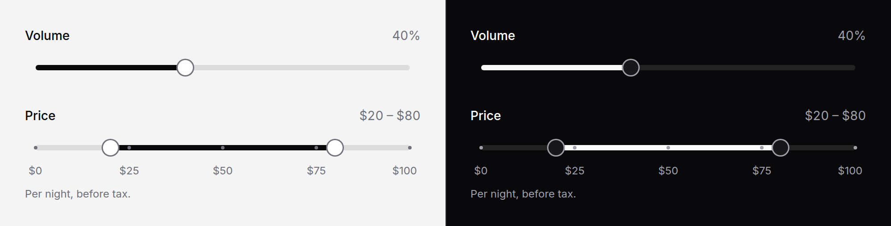

# Slider

A number on a track, or a range of two: a volume, an opacity, a price
filter. Native range inputs underneath, so the keyboard, touch and the form
are the browser's.



> **Needs Alpine** and the package's script. See [getting started](../getting-started.md#3-add-the-script).
> Without them a single slider still works as the browser's own; the fill stays where the server drew it.

## Use it

```blade
<x-ds::slider name="volume" label="Volume" :value="old('volume', 40)" showValue="inline" :format="['suffix' => '%']" />

<x-ds::slider
    name="price"
    label="Price"
    :range="true"
    :value="old('price', [20, 80])"
    lowLabel="Minimum price"
    highLabel="Maximum price"
    :minGap="10"
    showValue="inline"
    :format="['prefix' => '$']"
    :marks="[0 => '$0', 50 => '$50', 100 => '$100']"
/>
```

The range posts `price[low]` and `price[high]`, which PHP reads as one array:

```php
$request->validate([
    'price.low' => ['required', 'numeric', 'min:0', 'lte:price.high'],
    'price.high' => ['required', 'numeric', 'max:100'],
]);
```

## Props

| Prop | Type | Default | What it does |
|---|---|---|---|
| `name` | string | *required* | Submitted name. With `range`, posts `name[low]` and `name[high]`. |
| `label` | string | — | The field's label; with `range`, names the pair. |
| `help` | string | — | Guidance under the slider. |
| `error` | string | — | Validation message. Replaces `help`, colours the fill. |
| `min` | number | `0` | Lower bound. |
| `max` | number | `100` | Upper bound. Must be above `min`. |
| `step` | number \| `any` | `1` | One arrow-key press. |
| `value` | number, or `[low, high]` / `['low' => …, 'high' => …]` | midpoint, or `[min, max]` | Snapped to the bounds and the step, as the browser would. |
| `range` | bool | `false` | Two thumbs on one track. |
| `lowLabel`, `highLabel` | string | — | **Required with `range`**: each thumb's accessible name, "Minimum price". |
| `lowName`, `highName` | string | — | Post the thumbs under these names instead, e.g. `price_min`. |
| `minGap` | number | `0` | With `range`: how close the thumbs may come, in the slider's units. |
| `marks` | array | `[]` | `value => label`, drawn as ticks under the track; a list of numbers is labelled with their formatted values. |
| `showValue` | `none` `inline` `tooltip` | `none` | The value beside the label, or over the thumb while dragging and on keyboard focus. |
| `format` | array | `[]` | `prefix`, `suffix`, `decimals` (and `grouping`, `compact`, `locale`): how every readout and the announced value are written. |
| `disabled` | bool | `false` | |
| `size` | `md` `sm` | `md` | `md` is a field's height, so it lines up with the fields beside it; `sm` is 32px. |
| `histogram` | array | — | Bars of what the slider filters, drawn over the track: a count per bucket, equal widths from `min` to `max`; or, with `buckets`, the raw values. |
| `buckets` | int | — | Count `histogram`'s raw values into this many buckets. |
| `countLabel` | string | `":count result\|:count results"` | With `histogram`, the line saying how many fall in the range. `:count` is the number; before the `\|` is the one form. |
| `inputs` | bool | `false` | A number field per thumb under the slider, bound to it. Shown only with the script. |

Horizontal only. `wire:model` and `x-model` go on the component and bind the
number (or the pair); any other attribute goes on the wrapper, and the
inputs' own `input` and `change` events bubble to it.

## With Livewire and Alpine

```blade
<x-ds::slider name="volume" label="Volume" wire:model.live="volume" :value="$volume" />

<x-ds::slider name="price" label="Price" :range="true" lowLabel="Minimum price" highLabel="Maximum price"
    wire:model="price" :value="$price" />
```

A single slider binds a number. A range binds `[low, high]`, or
`['low' => …, 'high' => …]` if that is what the property holds: it is
handed back in the shape it came in. A value that does not fit (past a
bound, off the step, the thumbs too close) is drawn as the inputs take it and
handed back corrected. Pass `:value` as well as `wire:model`, as with every
bound field here, so a re-render draws the fill where the value is.

## Two thumbs

- **They do not cross.** Pushed into the other, a thumb stops `minGap` short
  of it. Without the script they can cross, because nothing stops one native
  input passing another; check `low <= high` on the server.
- **A press on the track** moves the nearer thumb there.
- **Two thumbs parked at one end** can still be pulled apart: the one that
  can move away is on top.

## A histogram

A price filter with the spread of prices behind it:

```blade
<x-ds::slider
    name="price"
    label="Price per night"
    :range="true"
    :value="[50, 200]"
    :max="500"
    step="10"
    lowLabel="Minimum price"
    highLabel="Maximum price"
    :format="['prefix' => '$']"
    showValue="inline"
    :histogram="$listings->pluck('price')"
    :buckets="25"
    countLabel=":count stay|:count stays"
    :inputs="true"
/>
```

- **The bars** sit over the track and line up with its scale: a bar covers the
  values it counts. The ones in the range are dark, the rest light, from PHP
  first and then as the thumbs move.
- **A bucket is in the range when its middle is.** The bars lit and the count
  are the same buckets, so the number always matches what you see. Make
  `step` a whole number of buckets wide and the edges fall exactly on bars.
- **The count** ("14 stays") updates as the thumbs move and is read out once
  they stop.
- **`inputs`** adds a number field per thumb. Typing moves the thumb once the
  number is one it can take; leaving the field moves it anyway, held short of
  the other thumb, and writes back where it landed.
- Raw values outside `min`..`max` are not counted. Pass counts you have
  already worked out, without `buckets`, when the data is large.

## Accessibility

- Each thumb is a native slider. A single one is named by `label`; in a range
  each has its own name (`lowLabel`, `highLabel`) and the pair is a group
  named by `label`.
- The announced value is the formatted one, "$20", not "20".
- The thumb is a 24px target at both sizes, and shows the focus ring in both
  themes. In forced colours it is drawn in the system highlight.
- In a right-to-left page the track runs right to left and the arrow keys
  follow it.
- The histogram is decorative (`aria-hidden`); the count beside it is in a
  polite status region, said half a second after the thumbs stop.

## Don't

- **Don't use it for an exact number.** A slider is for "about this much";
  a quantity someone types is a [number field](number-field.md).
- **Don't trust the order of a range.** Without the script the thumbs can
  cross; validate on the server.
- **Don't put meaning only in the histogram.** It is hidden from screen
  readers; the count line says what it shows.
- **Don't put meaning only in the marks.** Their labels are for the eye: the
  formatted value is what a screen reader hears.

More in [specs/slider.md](../../specs/slider.md).
