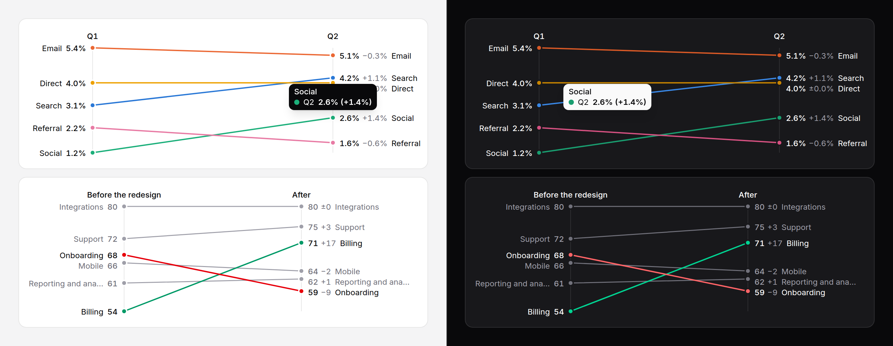

# Slope chart

A before-and-after for a handful of items: each item a line from its value at
the first point in time to its value at the second, named and valued on both
sides, with the change written out. Suits up to about ten items.



> **Needs Alpine** and the package's script for the readout and keyboard
> access to each point. Without them the chart is a correct static image with
> a generated text alternative. See
> [getting started](../getting-started.md#3-add-the-script).

## When to use it

When the question is **what changed between two moments, and for whom**:
conversion by channel this quarter and last, satisfaction by team before and
after a redesign. Crossing lines show a change in rank at a glance. For more
than two points in time use a [line chart](line-chart.md); for one moment, a
[bar chart](bar-chart.md).

## Use it

```blade
<x-ds::slope-chart label="Conversion by channel" fromLabel="Q1" toLabel="Q2"
    :format="['suffix' => '%', 'decimals' => 1]"
    :data="['Search' => [3.1, 4.2], 'Email' => [5.4, 5.1], 'Social' => [1.2, 2.6]]" />

{{-- Coloured by direction, two items picked out --}}
<x-ds::slope-chart label="Satisfaction by team" fromLabel="Before" toLabel="After"
    colourBy="direction" :highlight="['Billing', 'Onboarding']" :data="$teams" />

{{-- Rows, for a tone of your own --}}
<x-ds::slope-chart label="Median latency" fromLabel="v1" toLabel="v2" :format="['suffix' => ' ms']" :data="[
    ['label' => 'Search', 'from' => 320, 'to' => 290],
    ['label' => 'Login', 'from' => 180, 'to' => 260, 'tone' => 'danger'],
]" />
```

## Props

| Prop | Type | Default | What it does |
|---|---|---|---|
| `data` | array | `[]` | `['Oslo' => [120, 180], …]`, or rows with `label`, `from`, `to` and an optional `tone` or `series`. Both values must be numbers. |
| `fromLabel` | string | **required** | The first point in time: the left column's heading. |
| `toLabel` | string | **required** | The second: the right column's heading. |
| `label` | string | — | What the chart compares. Starts the summary, captions the table. |
| `colourBy` | `series` `direction` | `series` | A series colour per item (eight items at most), or `success` up, `danger` down and the neutral tone flat. A row's own `tone` or `series` wins either way. |
| `highlight` | string or list | — | The labels of the items to emphasise; the rest are drawn muted. |
| `height` | `sm` `md` `lg` | `md` | 160, 224 or 288px, and at least 16px per item. |
| `format` | array | `[]` | How numbers read, the change included; [counter's keys](counter.md#format). |
| `summary` | string | generated | The text alternative, in place of the generated one. |
| `table` | bool | `false` | Also give item, both values and the change as a visually hidden table. |
| `interactive` | bool | `true` | With the script: the readout and keyboard access. |
| `empty` | string | `No data to show` | The empty state's title. |

Labels that would overprint are nudged apart, each keeping its order; long
names are cut with an ellipsis and keep the full name as a tooltip. The value
scale runs from the lowest value to the highest, not from zero.

## Accessibility

- Without the script the chart is `role="img"`: "Conversion by channel: Q1 to
  Q2, 2 up and 1 down; the largest rise is Social (+1.4%), the largest fall
  Email (−0.3%)."
- Direction is never colour alone: every right-hand label carries its signed
  change ("+1.4%", "−0.3%", "±0.0%").
- With the script, one Tab stop: ArrowRight and ArrowLeft go along the points
  (an item's first, then its second), ArrowDown and ArrowUp to the same
  column of the next item in the order given, Home and End to the ends,
  Escape puts the readout away. The pointer reads the nearest point.

## Don't

- **Don't draw more than about ten items.** Filter, or `highlight` the few
  that matter.
- **Don't colour by direction when a rise is bad news** — cost, latency,
  churn. `success` would call it good. Give those rows a `tone`, or colour by
  series.
- **Don't use it for three or more points in time.** Use a line chart.

More in [specs/slope-chart.md](../../specs/slope-chart.md).
