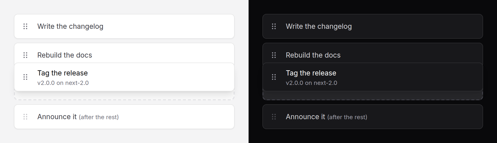

# Sortable list

Rows the reader puts in order: dragged by their handle, moved from the
keyboard, or nudged with Move up and Move down. The order posts as `name[]`.



> **Needs Alpine** and the package's script. See [getting started](../getting-started.md#3-add-the-script).
> Without them it is a plain list in the server's order, which posts that order, with no handles.

## Use it

```blade
<form method="POST" action="{{ route('checklists.order', $checklist) }}">
    @csrf
    <x-ds::sortable-list name="steps" label="Checklist steps">
        @foreach ($checklist->steps as $step)
            <x-ds::sortable-item :value="$step->id" :label="$step->title">
                {{ $step->title }}
            </x-ds::sortable-item>
        @endforeach
    </x-ds::sortable-list>
    <x-ds::button type="submit">Save order</x-ds::button>
</form>
```

```php
$ids = $request->validate(['steps' => ['required', 'array'], 'steps.*' => ['integer']])['steps'];

foreach ($ids as $position => $id) {
    $checklist->steps()->whereKey($id)->update(['position' => $position]);
}
```

## Props

### `sortable-list`

| Prop | Type | Default | What it does |
|---|---|---|---|
| `name` | string | — | Posts the order as `name[]`, one hidden input per row |
| `label` | string | — | The list's accessible name |
| `handle` | bool | `true` | Drag by the handle only. `false`: a mouse or pen drags from anywhere on a row that is not a control; touch keeps the handle, so the page scrolls |
| `disabled` | bool | `false` | Nothing moves; the order still posts |
| `instructions` | string | *English* | Read with each handle: how to move a row from the keyboard |
| `pickedText` `movedText` `droppedText` `cancelledText` | string | *English* | What the live region says; `:item`, `:position` and `:total` are filled in |
| `grabText` | string | `Reorder :item` | The handle's name |
| `moveUpText` `moveDownText` | string | `Move :item up` … | The row buttons' names |

### `sortable-item`

| Prop | Type | Default | What it does |
|---|---|---|---|
| `value` | string | *required* | What it posts and what `reorder` lists |
| `label` | string | its text | What the row is called in the handle's name, the buttons and the announcements |
| `disabled` | bool | `false` | Stays put: no handle, no buttons. Other rows can pass it |

## The `reorder` event

After every drop that changed the order, from the list, bubbling:

```js
{ order: ['3', '1', '2'], moved: '3', from: 2, to: 0 }   // positions from 0
```

## With Livewire

Give each row a `wire:key`, save the order, and let the component re-render:
the morph moves the rows to the saved order and the list carries on.

```blade
<x-ds::sortable-list label="Backlog" x-on:reorder="$wire.reorder($event.detail.order)">
    @foreach ($tasks as $task)
        <x-ds::sortable-item wire:key="task-{{ $task->id }}" :value="$task->id" :label="$task->title">
            {{ $task->title }}
        </x-ds::sortable-item>
    @endforeach
</x-ds::sortable-list>
```

```php
public function reorder(array $order): void
{
    foreach ($order as $position => $id) {
        Task::whereKey($id)->update(['position' => $position]);
    }
}
```

Save it. A list reordered in the browser and not saved goes back to the
server's order the next time the component re-renders.

## Keyboard

Tab to a row's handle, then:

| Key | |
|---|---|
| Space or Enter | Pick it up |
| ↑ ↓ | Move it one place |
| Space or Enter | Drop it |
| Escape | Put it back where it was |

Each step is announced: "Picked up Write the brief, position 1 of 3",
"Moved to position 2 of 3", "Dropped…". Move up and Move down are there for
anyone who cannot drag, keyboard or not; they show on a row's hover and
focus, and always on a touch screen.

## Accessibility

A list of list items. Each handle is a button named "Reorder" and the row,
described by the instructions above, pressed while its row is picked up. No
move needs a drag (WCAG 2.5.7), focus stays on the handle through every move,
and the slide and settle are `motion-safe`: with reduced motion the rows jump.

## Don't

- **Don't leave out `value`.** The position is not an identity.
- **Don't rely on the DOM order surviving.** Persist `reorder`, or the next
  re-render restores the server's order.
- **Don't put frequently pressed controls in a row with `:handle="false"`.**
  Presses on controls are passed through, but the row's text can no longer be
  selected with the mouse.
- **Don't use it to move rows between lists**, or for a grid. Neither is
  supported.
