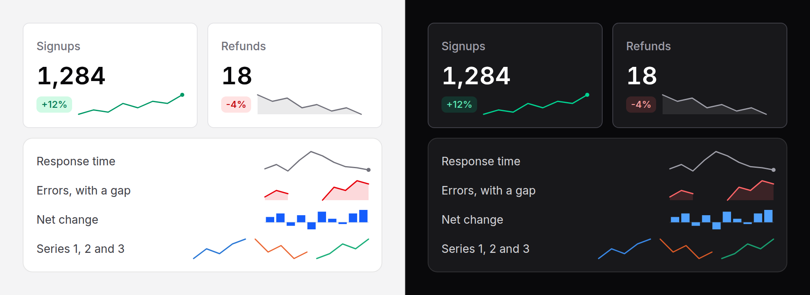

# Sparkline

A small chart with no axes, read for its shape: is it going up, and is the
latest point high or low. A line, a filled area or bars.



## Use it

```blade
<x-ds::sparkline :values="$weekly" label="Signups, last eight weeks" />
<x-ds::sparkline :values="$errors" variant="area" tone="danger" width="lg" />
<x-ds::sparkline :values="$net" variant="bar" />
```

In a [stat tile](stat-tile.md), through its `caption` slot:

```blade
<x-ds::stat-tile label="Signups" :value="$total" :delta="12">
    <x-slot:caption>
        <x-ds::sparkline :values="$weekly" tone="success" width="lg" :showLast="true" label="Signups, last eight weeks" />
    </x-slot:caption>
</x-ds::stat-tile>
```

## Props

| Prop | Type | Default | What it does |
|---|---|---|---|
| `values` | array | `[]` | The values, oldest first. Keys, if you give them (`['Mon' => 3]`), name the rows of `table`. `null` is a gap. |
| `variant` | `line` `area` `bar` | `line` | The mark. |
| `tone` | `neutral` `accent` `success` `warning` `danger` | `neutral` | For a trend whose colour means something. |
| `series` | `1` to `8` | — | The [chart-series](../../specs/chart-series.md) slot, for a trend that is one of several. Wins over `tone`. |
| `width` | `sm` `md` `lg` `full` | `md` | 64, 96 or 128px, or the container's width. |
| `height` | `sm` `md` `lg` | `md` | 16, 24 or 32px. |
| `min` / `max` | number | the data's | Fix the scale, so two sparklines compare. |
| `showLast` | bool | `false` | A dot on the latest value. |
| `label` | string | — | What the values are. Starts the generated summary and captions the table. |
| `summary` | string | generated | The text alternative, in place of the generated one. |
| `table` | bool | `false` | Also give every value to assistive technology, as a visually hidden table. |
| `format` | array | `[]` | How numbers read in the summary and table; the keys are [counter's](counter.md#format). |

The chart stretches to its box and its strokes keep their width, so `full`
fits any container.

## The data it handles

- **Empty**: a dashed rule, and the summary "No data."
- **One value**: a dot in the middle.
- **All equal**: a flat line through the middle, "Flat at 7."
- **Negatives**: lines and areas scale to them. Bars grow up and down from a
  zero baseline, which is drawn.
- **Gaps** (`null`): the line breaks and the bar is missing; the line does not
  bridge the gap, because that would invent values.

## Accessibility

- The chart is `role="img"`, named by a summary written from the data: "Signups:
  up from 12 to 30 (low 8, high 30)." Pass `summary` when you can say it
  better ("Fell after the price change").
- `table` adds the values themselves, for a reader who wants them. A sparkline
  with a number beside it rarely needs it.
- The trend is in the summary in words; colour is never the only signal.
- Not focusable, no tooltip, no keyboard interaction.

## Don't

- **Don't use it where the numbers matter.** It has no axes on purpose. If a
  reader needs to read values off it, it is a chart, not a sparkline.
- **Don't put two series in one sparkline.** Put two sparklines side by side,
  with `series` and the same `min` and `max`.
- **Don't colour a neutral trend.** Up is not always good; `success` says it
  is.
- **Don't leave `label` off where there are several.** "Up from 12 to 30" says
  nothing about what went up.

More in [specs/sparkline.md](../../specs/sparkline.md).
