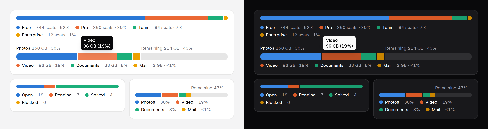

# Split bar

One bar cut into the parts of a whole — plan mix, storage by type, ticket
status — with each part's name and number in a legend or over its own
segment. A `total` larger than the parts leaves the rest as empty track.



> **Needs Alpine** and the package's script for the readout and keyboard
> access to each segment. Without them the bar is a correct static image with
> a generated text alternative. See
> [getting started](../getting-started.md#3-add-the-script).

## Split bar, usage meter or progress?

All three are a bar. They answer different questions.

| | Use it for | Role |
|---|---|---|
| **Split bar** | What a whole is made of: several parts side by side, each named. "Storage: photos, video, documents, 214 GB free." | an image of the parts, with a summary |
| [Usage meter](usage-meter.md) | How much of one allowance is used, and whether that is a problem: "42 of 50 credits", turning warning and danger at its thresholds. Its `segments` break the used part down, but the question is still the limit. | `meter` |
| [Progress](progress.md) | How far a task has got toward done. "Uploading, 40%." | `progressbar` |

A quota with a warning at 80% is a usage meter, even broken down by type.
What the storage is made of, with no limit to warn about, is a split bar: it
has series colours, inline names, a readout, and percentages that add up to
100. For a few parts where the share
of the whole is the only question, a [donut chart](donut-chart.md) is the
other option; the split bar takes less height and reads left to right.

## Use it

```blade
<x-ds::split-bar label="Plan mix" :data="['Free' => 744, 'Pro' => 360, 'Team' => 84]" />

{{-- Storage with room left: the rest is empty track, named "Remaining" --}}
<x-ds::split-bar label="Storage" :total="$quotaGb" legend="inline" :format="['suffix' => ' GB']"
    :data="['Photos' => $photos, 'Video' => $video, 'Documents' => $documents]" />

{{-- Ticket status: a tone where the colour means something --}}
<x-ds::split-bar label="Tickets" size="sm" showValues="value" :data="[
    ['label' => 'Open', 'value' => $open, 'tone' => 'warning'],
    ['label' => 'Solved', 'value' => $solved, 'tone' => 'success'],
]" />
```

## Props

| Prop | Type | Default | What it does |
|---|---|---|---|
| `data` | array | `[]` | `['Free' => 744, …]`, or rows with `label`, `value` and an optional `tone` or `series`. Zero or more each; a zero is listed and not drawn. A negative throws. Eight parts at most. |
| `total` | number | — | The whole, when it is more than the parts. The rest draws as empty track. |
| `label` | string | — | What the whole is. Starts the summary, captions the table. |
| `legend` | `below` `inline` `none` | `below` | A legend under the bar; each part named over its segment (falling back to a line under the bar when the segment is too narrow); or neither. |
| `showValues` | `value` `percent` `both` | `both` | The number beside each name: "150 GB", "30%" or "150 GB · 30%". |
| `size` | `sm` `md` `lg` | `md` | Thickness: 8, 12 or 20px. |
| `remainderLabel` | string | `Remaining` | What the rest of `total` is called. |
| `format` | array | `[]` | How numbers read; [counter's keys](counter.md#format). |
| `summary` | string | generated | The text alternative, in place of the generated one. |
| `table` | bool | `false` | Also give part, value and share as a visually hidden table. |
| `interactive` | bool | `true` | With the script: the readout and keyboard access. |
| `empty` | string | `No data to show` | The empty state's title. |

The percentages always add up to exactly 100, the rest included: they are
rounded by largest remainder. A part too small to round to 1% says `<1%`,
because it is still on the bar, at a minimum width.

## Accessibility

- Without the script the bar is `role="img"`, named by the gist: "Storage: 3
  parts, 284 GB of 500 GB; the largest is Photos at 30%." The legend lists
  every part as text. With `legend="none"` the name lists every part.
- With it, one Tab stop: any arrow moves segment to segment, the rest of the
  track included, Home and End to the ends, Escape puts the readout away.
  Each segment is named "Photos: 150 GB (30%)" and draws its own focus ring.
- With `legend="inline"` every part is named once at every width: over its
  segment while it fits, under the bar while it does not, switched by
  container query with nothing measured.

## Don't

- **Don't use it for one value against a limit.** That is a usage meter.
- **Don't pass parts that are not one whole** (answers where several could be
  picked). Use a bar chart.
- **Don't compare parts closely with it.** Only the first segment starts at a
  common line. Use a bar chart, sorted.
- **Don't use `legend="none"`** unless the parts are named right beside it.

More in [specs/split-bar.md](../../specs/split-bar.md).
