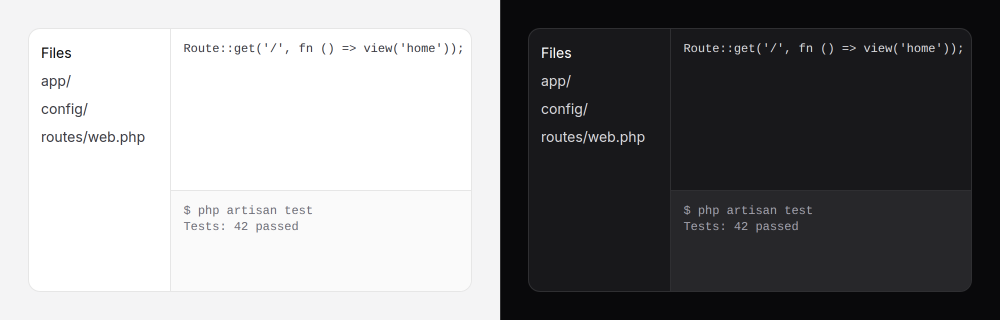

# Split

Panes side by side, or stacked, with a divider between each pair that the
reader drags to resize: a file list beside an editor, a console under it.



> **Needs Alpine** and the package's script. See [getting started](../getting-started.md#3-add-the-script).
> Without them the panes are fixed at their sizes and the dividers are plain lines.

## Use it

```blade
<div class="h-[calc(100dvh-4rem)]">
    <x-ds::split name="mail" label="Resize the folder list" stackBelow="md">
        <x-ds::split-pane size="25%" min="180" max="40%" :collapsible="true">
            @include('mail.folders')
        </x-ds::split-pane>
        <x-ds::split-pane>
            @include('mail.messages')
        </x-ds::split-pane>
    </x-ds::split>
</div>
```

The split fills its box: give the box a height. Leave one pane without a
`size`; it takes the room the others leave.

## Nested

A vertical split inside a pane of a horizontal one:

```blade
<x-ds::split label="Resize the sidebar">
    <x-ds::split-pane size="240px" min="160">Files</x-ds::split-pane>
    <x-ds::split-pane>
        <x-ds::split orientation="vertical" label="Resize the console">
            <x-ds::split-pane>Editor</x-ds::split-pane>
            <x-ds::split-pane size="30%" min="80" :collapsible="true">Console</x-ds::split-pane>
        </x-ds::split>
    </x-ds::split-pane>
</x-ds::split>
```

## Props

### `split`

| Prop | Type | Default | What it does |
|---|---|---|---|
| `orientation` | `horizontal` \| `vertical` | `horizontal` | Side by side, or stacked |
| `name` | string | — | Handed back in the events, to tell splits apart |
| `label` | string | `Resize` | Each divider's accessible name |
| `stackBelow` | `sm` `md` `lg` `xl` | — | Below that breakpoint the panes stack at their natural height and the dividers go |

### `split-pane`

| Prop | Type | Default | What it does |
|---|---|---|---|
| `size` | `%`, `px`, `rem`, number (px) | — | Its first size. Left out, it takes what is left |
| `min` | as `size` | — | The smallest it can be dragged to |
| `max` | as `size` | — | The largest |
| `collapsible` | bool | `false` | Enter or a double-click on its divider folds it away and brings it back |

A pane's divider is the one after it; the last pane's is the one before it.

## Events

From the split, bubbling, with `{ name, sizes }` (a percentage per pane):

| Event | When |
|---|---|
| `resize` | While a divider is dragged, at most once a frame |
| `resized` | When the drag ends, after each key, after a fold |

## Remember the sizes

The split stores nothing. Save `resized` and pass the sizes back:

```blade
@php $sizes = json_decode(request()->cookie('mail-split', '[25]'), true); @endphp

<x-ds::split name="mail" x-on:resized="document.cookie = 'mail-split=' + JSON.stringify($event.detail.sizes) + '; path=/; max-age=31536000'">
    <x-ds::split-pane :size="($sizes[0] ?? 25).'%'" min="180">…</x-ds::split-pane>
    <x-ds::split-pane>…</x-ds::split-pane>
</x-ds::split>
```

A cookie, so the server renders the saved sizes and the first paint is right.
Laravel encrypts cookies, and this one is written by the browser: list it in
`encryptCookies(except: ['mail-split'])` in `bootstrap/app.php`.
`localStorage` works too, but the page then paints the default first and
jumps. From Livewire, `x-on:resized="$wire.saveLayout($event.detail.sizes)"`,
and render the saved sizes: a re-render puts each pane back at the `size` it
renders.

## Keyboard

Tab to a divider, then:

| Key | |
|---|---|
| ← → (↑ ↓ when stacked vertically) | Move it 1% |
| Shift + arrow | Move it 10% |
| Home, End | The pane it controls to its smallest, its largest |
| Enter | Fold a collapsible pane, and bring it back |

## Accessibility

Each divider is a focusable `separator` (the ARIA window splitter pattern)
named by `label`, controlling one pane, whose share of the split is its
`aria-valuenow` in percent. Its hit area is 24px wide though the line is 1px.
While a divider is dragged a layer covers the page, so an iframe in a pane
cannot swallow the drag. A folded pane is hidden from Tab.

## Don't

- **Don't size every pane.** Sizes that do not add up then leave a gap.
- **Don't put it in a box with no height.**
- **Don't fold away the only copy of something on a phone.** Use
  `stackBelow`.
