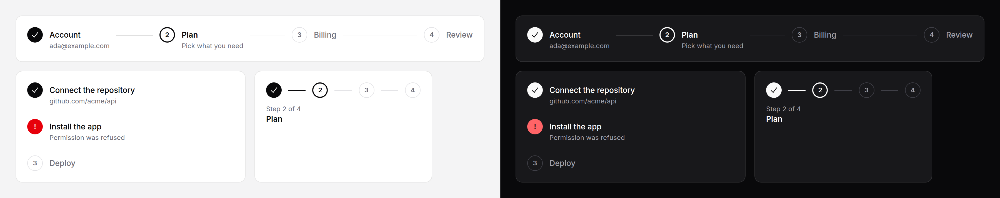

# Stepper

Where someone is in a flow of several steps: checkout, onboarding, a setup
wizard.



## Use it

```blade
<x-ds::stepper label="Checkout progress">
    <x-ds::step status="complete" title="Account" :href="route('checkout.account')" />
    <x-ds::step status="current" title="Plan" description="Pick what you need" />
    <x-ds::step status="upcoming" title="Billing" />
    <x-ds::step status="upcoming" title="Review" />
</x-ds::stepper>
```

The stepper holds no state. **You say which step is current**, from whatever
your flow already knows: the route, a wizard's step property, a session key.
Steps number themselves in order.

## Props

**`ds::stepper`**

| Prop | Type | Default | What it does |
|---|---|---|---|
| `orientation` | `horizontal` `vertical` | `horizontal` | A row, or a column with a connector down the side. |
| `label` | string | — | Names the list for a screen reader: "Checkout progress". |

**`ds::step`**

| Prop | Type | Default | What it does |
|---|---|---|---|
| `status` | `complete` `current` `upcoming` `error` | `upcoming` | Where this step stands. |
| `title` | string | — | The step's name. Required. |
| `description` | string | — | One line under the title. |
| `href` | string | — | Makes the step a link, usually so a completed step can be revisited. Ignored on the `current` step. |

## Narrow widths

Below **40rem of the stepper's own width** a horizontal stepper keeps its row
of markers, drops the titles from the screen, and prints the position and the
current title underneath:

```
(✓)──(2)──(3)──(4)
Step 2 of 4
Plan
```

It measures its container, not the window, so a four-step flow inside a
narrow modal on a desktop collapses too. That makes it a CSS container, so it
always takes the full width of its parent (`w-full`), even in a flex row: a
container cannot size itself from its own content. Constrain the parent, not
the stepper.

With no current step the line counts what is done ("2 of 4 steps complete");
an `error` step is treated as the current one. The titles stay in the list for
screen readers, and a linked step is still its marker, so it stays clickable
and its focus ring visible.

Vertical steppers never collapse; they are already narrow.

## Statuses

| Status | Marker | Spoken |
|---|---|---|
| `complete` | filled, with a check | "completed" |
| `current` | ringed, numbered; title in semibold | "current step", plus `aria-current="step"` |
| `upcoming` | outlined, numbered; title muted | "not started" |
| `error` | red, with "!" | "needs attention" |

Put the reason for an `error` in `description`.

## Accessibility

- An `ol`, so a screen reader announces "list, 4 items" and each position.
- The current step carries `aria-current="step"`.
- Every status is also in words, hidden visually, after the title: colour and
  a glyph are not enough on their own.
- It has no keyboard behaviour of its own. Steps with an `href` are ordinary
  links in the tab order; the rest are not focusable.

## Don't

- **Don't use it as navigation between independent pages.** That is
  [tabs](tabs.md) or a nav. A stepper says the steps happen in order.
- **Don't link the upcoming steps** unless your flow really allows skipping
  ahead; a link that leads to a "finish step 2 first" page is a trap.
- **Don't mark more than one step `current`.**
- **Don't run past about six steps horizontally.** It collapses gracefully, but
  a flow that long wants splitting or a vertical stepper.

More in [specs/stepper.md](../../specs/stepper.md).
