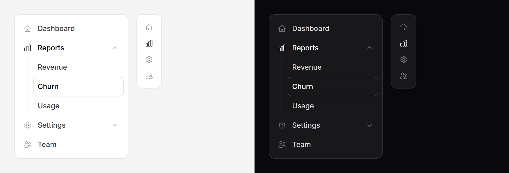

# Sub-nav

A rail item that holds the pages belonging to it.



> **Needs Alpine** to open and close. See
> [getting started](../getting-started.md#alpine). Without it, the section
> holding the current page is open and the rest are closed, as the server
> rendered them.

## Use it

```blade
<nav aria-label="Primary" class="rounded-panel border border-border bg-surface p-2">
    <x-ds::nav-item href="/" label="Dashboard" :active="request()->is('/')">
        <x-slot:icon><x-ds::icon name="home" /></x-slot:icon>
    </x-ds::nav-item>

    <x-ds::sub-nav label="Reports">
        <x-slot:icon><x-ds::icon name="chart-bar" /></x-slot:icon>

        <x-ds::nav-item href="/reports/revenue" label="Revenue" :active="request()->is('reports/revenue')" />
        <x-ds::nav-item href="/reports/churn" label="Churn" :active="request()->is('reports/churn')" />
    </x-ds::sub-nav>
</nav>
```

The pages are ordinary [nav items](nav-item.md), with `active` set the way
you already set it. The section opens itself when one of them is active; you
do not tell it.

## Props

| Prop | Type | Default | What it does |
|---|---|---|---|
| `label` | string | *required* | The section's name, on the button. |
| `open` | bool | *open when a page in it is active* | Starts the section open or closed. |
| `collapsedWhen` | Alpine expression | — | True when the rail is collapsed to icons. The same expression the rail's nav items take. |
| `href` | string | *the first page's* | Where the section links to when the rail is collapsed. |
| `chip` | bool | `false` | Wraps the icon in a tinted chip, as nav-item does. |

The icon is a **slot**, `<x-slot:icon>`, as on nav-item.

Drawing the same rail twice on one page, say in the sidebar and in a phone
sheet? Give each sub-nav an `id`. The button and its pages are named from it,
and two identical sections would otherwise share theirs.

## The section and the page are marked differently

The page you are on is the raised card, on its own row. The section it sits
in has its label and icon at full strength and no card. One card on the rail,
always on the page itself.

## Collapsing the rail

Pass the rail's `collapsedWhen` to the sub-nav **and** to each page in it:

```blade
<div x-data="{ railCollapsed: false }">
    <x-ds::sub-nav label="Reports" collapsedWhen="railCollapsed">
        <x-slot:icon><x-ds::icon name="chart-bar" /></x-slot:icon>
        <x-ds::nav-item href="/reports/revenue" label="Revenue" collapsedWhen="railCollapsed" />
        <x-ds::nav-item href="/reports/churn" label="Churn" collapsedWhen="railCollapsed" />
    </x-ds::sub-nav>
</div>
```

Collapsed, the pages are hidden and the section's icon is a **link to its
first page** (or to `href`). There is no room beside an icon for the pages,
and one press reaches the section. Expand the rail and each section is open or
closed as it was left.

## Don't

- **Don't nest a sub-nav in a sub-nav.** A third level belongs on the page, as
  [tabs](tabs.md).
- **Don't mark the section active.** One of its pages is.
- **Don't open every section.** Leave `open` out and only the one holding the
  current page opens.
- **Don't use it for a page's own sections.** That is
  [accordion](accordion.md).

More in [specs/sub-nav.md](../../specs/sub-nav.md).
