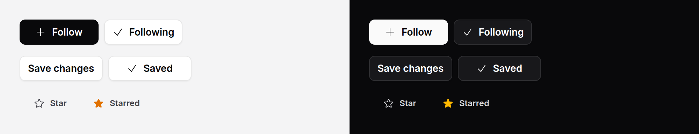

# Swap button

A button that answers in place: "Save" becomes "Saved", "Follow" becomes
"Following". The same mechanics as [copy button](copy-button.md), for any
action.



> **Needs Alpine** and the package's script. See [getting started](../getting-started.md#3-add-the-script).

## Use it

A confirmation that goes back by itself, 2 s after the press:

```blade
<x-ds::swap-button type="submit">
    Save changes
    <x-slot:swapped><x-ds::icon name="check" /> Saved</x-slot:swapped>
</x-ds::swap-button>
```

A toggle, with `revert="0"`: it stays swapped until pressed again, and says
it is pressed. Give it the server's state so the first paint is right:

```blade
<x-ds::swap-button :revert="0" :swapped="$user->follows($author)" wire:click="toggleFollow">
    <x-ds::icon name="plus" /> Follow
    <x-slot:swapped><x-ds::icon name="check" /> Following</x-slot:swapped>
</x-ds::swap-button>
```

Swapped when the save has worked rather than when it was asked for: name the
event the save dispatches, and the press itself changes nothing.

```blade
{{-- In the component: $this->dispatch('profile-saved') after the save --}}
<x-ds::swap-button type="submit" event="profile-saved">
    Save profile
    <x-slot:swapped><x-ds::icon name="check" /> Saved</x-slot:swapped>
</x-ds::swap-button>
```

## Props and slots

| Prop | Type | Default | What it does |
|---|---|---|---|
| `swapped` | bool | `false` | The server's state: render with the swapped face showing. Read from the attributes, so it can share its name with the slot. |
| `revert` | int (ms) | `2000` | How long the swapped face shows before the button swaps back by itself. `0` stays swapped. |
| `event` | string | — | Swap when this event reaches the window: a Livewire `dispatch()`, or anything that bubbles. |
| `swapOnClick` | bool | `true`, or `false` with `event` | A press swaps it. With `revert="0"` a press swaps it back, which makes it a toggle. |
| `variant` | string | `secondary` | As [button](button.md). |
| `size` | string | `md` | As [button](button.md). |

| Slot | What goes in it |
|---|---|
| default | The face at rest: words, with an icon if you like. |
| `swapped` | The face it swaps to. Required: without it the view throws. |

Anything else (`type`, `href`, `wire:click`, `@click`, `id`, `class`) goes on
the [button](button.md), so it still submits its form or follows its link,
with or without the script.

## What it does

- **The width does not move.** Both faces share one grid cell from the first
  paint, so the button is as wide as the wider face, and the narrower sits in
  the middle.
- **The faces crossfade and slide** a few pixels, with the motion tokens. With
  reduced motion they change at once.
- **A press while swapped** starts the time again, as a second copy does.
- **Rendered swapped**, after a save that reloaded the page, it still swaps
  back after `revert`.
- **Without the script** it shows the server's face and is an ordinary button.

## Accessibility

- The face not showing is `aria-hidden` and `inert`, so it is neither read nor
  reachable.
- Every change is announced through a polite `role="status"` region beside the
  button, outside it: text inside would join its name.
- **As a toggle** (`revert="0"`, pressed to swap) it carries `aria-pressed`,
  and its name stays the face at rest, "Follow", through `aria-labelledby`. A
  toggle whose name changed with its state would say both things at once.
- Otherwise its name is the face showing.

## Don't

- **Don't swap before the work is done.** If the press only starts a save, use
  `event` and dispatch it when the save succeeds.
- **Don't use it for a choice between two settings.** That is a
  [switch](switch.md) or a [segmented control](segmented-control.md).
- **Don't make the swapped face say what the press will do next** ("Unfollow").
  It says the state: "Following".

More in [specs/swap-button.md](../../specs/swap-button.md).
