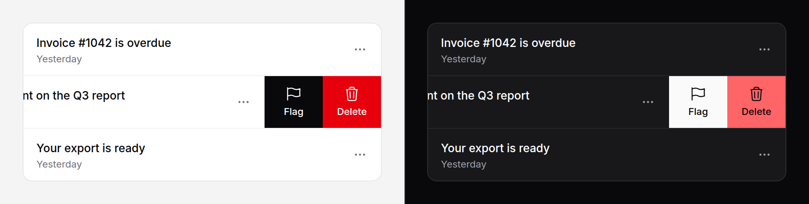

# Swipe actions

A list row that slides sideways to show the actions under it. Covers
`swipe-actions` and `swipe-action`.



> **Needs Alpine** and the package's script. See [getting started](../getting-started.md#3-add-the-script).
> Without them the actions sit after the row's content, as ordinary buttons.

## Use it

```blade
<ul role="list" class="divide-y divide-divider">
    @foreach ($messages as $message)
        <li>
            <x-ds::swipe-actions :full="true">
                <a href="{{ route('messages.show', $message) }}" class="block px-4 py-3">{{ $message->subject }}</a>

                <x-slot:start>
                    <x-ds::swipe-action label="Archive" icon="archive-box" tone="accent"
                                        form="archive-{{ $message->id }}" type="submit" />
                </x-slot:start>
                <x-slot:end>
                    <x-ds::swipe-action label="Flag" icon="flag" x-on:click="$wire.flag({{ $message->id }})" />
                    <x-ds::swipe-action label="Delete" icon="trash" tone="danger" x-on:click="$wire.delete({{ $message->id }})" />
                </x-slot:end>
            </x-ds::swipe-actions>
        </li>
    @endforeach
</ul>
```

Swiping toward the start shows the `end` actions; toward the end shows the
`start` ones. In a right-to-left page that flips by itself.

## `swipe-actions` props

| Prop | Type | Default | What it does |
|---|---|---|---|
| `threshold` | int (px) | `56` | How far a drag has to travel for the row to stay open. A flick counts. |
| `full` | bool | `false` | A swipe most of the way across presses the action at that side's outer edge (start's first, end's last) and dispatches `swipe` with `{ side }`. |
| `disabled` | bool | `false` | No swiping: the actions stay after the content. |
| `group` | string | — | Rows that close each other. By default, the rows of the nearest list. |
| `moreLabel` | string | `More actions` | The name of the More button. |

Slots: the default slot is the row's content; `start` and `end` hold the
actions.

## `swipe-action` props

| Prop | Type | Default | What it does |
|---|---|---|---|
| `label` | string | *required* | The words, under the icon. |
| `icon` | string | — | A heroicon name. |
| `tone` | `neutral` `accent` `danger` | `neutral` | |

It is a `<button type="button">`; any other attribute (`type="submit"`,
`form`, `wire:click`, `x-on:click`) goes on it.

## Every action has a way in without a swipe

- **More**, at the end of the content, opens the end side, then the start
  side, then closes.
- **Tab** onto an action opens its side; **Escape** closes the row and puts
  focus on More.
- Without the script the actions are simply there, after the content.

## Behaviour

- One row open at a time in a list (or a `group`).
- A tap on the content of an open row closes it, and does not follow the link.
- A drag that starts vertical is the page's scroll (`touch-action: pan-y`).
- A mouse drag works too.

## With Livewire

An action is a button: `wire:click` on it is all it needs. With `full`, the
swipe presses that same button, so there is one handler. To animate a row
away before the server removes it, listen for `swipe` on the list:

```blade
<ul role="list" x-on:swipe="$event.target.closest('li').classList.add('opacity-0')">
```

## Don't

- **Don't make a swipe the only way to an action.** It is a shortcut.
- **Don't put form fields in the row's content.**
- **Don't give a side more than three actions.**

More in [specs/swipe-actions.md](../../specs/swipe-actions.md).
