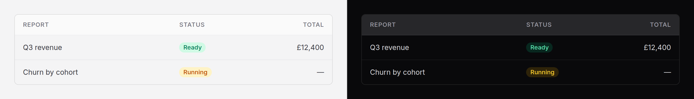
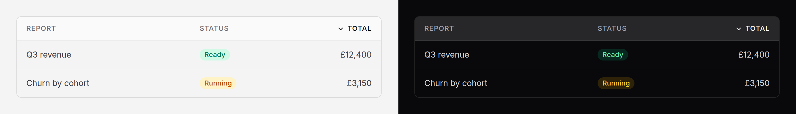

# Table

Rows of records. Covers `table`, `table-row` and `table-cell`.



## Use it

Headers come from the **`columns` prop**, not from a slot:

```blade
<x-ds::table :columns="['Report', 'Status', ['label' => 'Total', 'align' => 'right']]">
    @foreach ($reports as $report)
        <x-ds::table-row>
            <x-ds::table-cell>
                <a href="{{ route('reports.show', $report) }}" class="font-medium text-fg hover:underline">{{ $report->name }}</a>
            </x-ds::table-cell>
            <x-ds::table-cell :nowrap="true">
                <x-ds::badge :tone="$report->tone">{{ $report->status }}</x-ds::badge>
            </x-ds::table-cell>
            <x-ds::table-cell align="right">{{ $report->total }}</x-ds::table-cell>
        </x-ds::table-row>
    @endforeach
</x-ds::table>
```

## `columns`

Each entry is either a **label**, or an array:

```php
['label' => 'Joined', 'align' => 'right', 'width' => 'w-36']
```

| Key | Values | What it does |
|---|---|---|
| `label` | string | The header text. An empty string reserves the column without a heading — for an actions column. |
| `align` | `left` `center` `right` | Defaults to `left`. |
| `width` | Tailwind class | Fixes the column width. |
| `sortable` | bool | The reader can sort by this column: its header becomes a link or button. See [Sorting](#sorting). |
| `key` | string | The name the server sorts this column by. Required with `sortable`; the entry's own array key works too. |

Omit `columns` entirely and supply your own `<thead>` in the slot.

> **`width` is a class from *your* source.** It works because Tailwind scans your
> views and finds the literal `w-36` there. Build it dynamically — `'w-'.$n` — and
> it silently has no rule and no width. Write it out.

## Sorting

The table says which column the rows are sorted by and lets the reader ask for
another order. **It never sorts anything itself**: your query does, from the
`sort` and `direction` it is given.

```blade
<x-ds::table
    :sort="request('sort', 'created_at')"
    :direction="request('direction', 'desc')"
    :columns="[
        ['label' => 'Report', 'key' => 'name', 'sortable' => true],
        'Status',
        ['label' => 'Total', 'key' => 'total', 'align' => 'right', 'sortable' => true],
        ['label' => 'Created', 'key' => 'created_at', 'sortable' => true],
    ]"
>
    @foreach ($reports as $report) … @endforeach
</x-ds::table>
```

```php
$reports = Report::query()
    ->orderBy(in_array($request->sort, ['name', 'total', 'created_at']) ? $request->sort : 'created_at',
              $request->direction === 'asc' ? 'asc' : 'desc')
    ->paginate();
```

Each sortable header is a link. A press on the sorted column asks for the
other direction; a press on any other asks for ascending. By default the link
is the current URL with `sort` and `direction` set in the query string and
`page` dropped, since a new order starts on page one. Validate both against a
list of your own before they reach a query, as above.



| Prop | Type | Default | What it does |
|---|---|---|---|
| `sort` | string | — | The `key` of the column the rows are sorted by. |
| `direction` | string | `asc` | `asc` or `desc`. |
| `sortUrl` | string, Closure | — | Where a header links instead of the default: a pattern such as `/reports?order={key}&dir={direction}`, or `fn ($key, $direction) => route('reports.index', [...])`. `{direction}` is the one the press asks for. |
| `sortAction` | string, Closure | — | For Livewire: the header becomes a button with this `wire:click`, a pattern such as `sortBy('{key}')` or a closure. Wins over `sortUrl`. |

### With Livewire

```blade
<x-ds::table :sort="$sort" :direction="$direction" sortAction="sortBy('{key}')" :columns="$columns">
```

```php
public string $sort = 'created_at';
public string $direction = 'desc';

public function sortBy(string $key): void
{
    $this->direction = $this->sort === $key && $this->direction === 'asc' ? 'desc' : 'asc';
    $this->sort = $key;
    $this->resetPage();
}
```

A plain link would reload the page, which is why Livewire gets a button. The
default link reads the current request's URL, which inside a Livewire update is
Livewire's own endpoint: pass `sortAction`, not nothing.

### What the reader sees

- The sorted column's label is full strength, with an arrow: up for
  ascending, down for descending.
- Every other sortable header shows a faint up-and-down arrow under the
  pointer or keyboard focus, in space that is always kept, so the label never
  moves.
- On a right-aligned column the arrow sits inside the label, so the label's
  edge stays on the figures' edge.

## `table-row` and `table-cell`

| Component | Prop | Default | What it does |
|---|---|---|---|
| `table-row` | `hover` | `true` | Row hover fill. |
| `table-cell` | `align` | `left` | `left` `center` `right`. |
| `table-cell` | `nowrap` | `false` | Stops the cell wrapping. |

**`nowrap` is right for dates, counts and badges; wrong for prose** — a
non-wrapping sentence forces the whole table sideways.

## Linking a row

**`table-row` has no `href`.** A `<tr>` cannot be a link, and wrapping one in an
`<a>` is invalid HTML. Until v1.2.1 this page documented an `href` prop that the
component never had: it rendered `<tr href="…">`, which the browser ignores, and
the row looked clickable and went nowhere.

Link from a cell instead, either the first cell's text or a trailing action:

```blade
<x-ds::table-row>
    <x-ds::table-cell>{{ $report->name }}</x-ds::table-cell>
    <x-ds::table-cell align="right">
        <x-ds::button variant="ghost" size="sm" :href="route('reports.show', $report)">View</x-ds::button>
    </x-ds::table-cell>
</x-ds::table-row>
```

Both are real links: they take focus, open in a new tab, and carry anything
else you put on them, such as Livewire's `wire:navigate`.

## It scrolls inside its own box

The table sits in an `overflow-x-auto` container, so a wide table scrolls within
its rounded border rather than pushing the page sideways. On a phone, a page
that scrolls horizontally is indistinguishable from a broken one.

## Empty tables

Keep the header and put an [empty state](empty-state.md) in the body — the
reader needs to know *what* is empty:

```blade
<x-ds::table :columns="['Report', 'Status']">
    @forelse ($reports as $report)
        …
    @empty
        <tr><td colspan="2">
            <x-ds::empty-state title="No reports yet" :bare="true" />
        </td></tr>
    @endforelse
</x-ds::table>
```

## Accessibility

- Headers are `th scope="col"`.
- The sorted column's header carries `aria-sort="ascending"` or
  `"descending"`; no other header has `aria-sort`, so a screen reader names
  one sort and only one.
- Each sortable header is a real link or button inside the `th`, named by its
  label, reachable by Tab and pressed with Enter. The arrow is decorative
  (`aria-hidden`): the state is in `aria-sort`.

## Don't

- **Don't sort in the view.** The table presents an order; the query makes it.
- **Don't pass `sort` and `direction` from the request into a query
  unchecked.** Compare them against your own list of columns.
- **Don't make the row itself the link.** See above: link a cell.
- **Don't build `width` dynamically.** See above.
- **Don't use a table for layout.**

More in [specs/table.md](../../specs/table.md).
