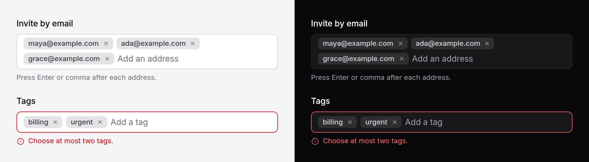

# Tag input

Short text values, typed into a field and kept as removable chips: email
addresses to invite, labels on a record, keywords.



> **Needs Alpine** and the package's script. See [getting started](../getting-started.md#3-add-the-script).

## Use it

```blade
<x-ds::tag-input
    name="emails"
    label="Invite by email"
    :value="old('emails', [])"
    validate="email"
    placeholder="Add an address"
    help="Press Enter or comma after each address."
/>
```

Each chip posts as `emails[]`, so the request carries an array, which is what
`old('emails')` and Laravel's `array` rule expect.

## Props

| Prop | Type | Default | What it does |
|---|---|---|---|
| `name` | string | *required* | Each tag posts as `name[]`. The `[]` is added for you. |
| `label` | string | — | Field label. |
| `help` | string | — | Guidance under the field. |
| `error` | string | — | Validation message. Replaces `help`. |
| `value` | array | `[]` | The tags already chosen, rendered as chips by the server. |
| `placeholder` | string | — | Shown in the text box. |
| `max` | int | — | The most tags it takes. |
| `separators` | array | `['Enter', ',']` | What commits the text: `'Enter'`, and any single character. |
| `unique` | bool | `true` | Refuse a tag already in the list, compared without case. |
| `validate` | `'email'` | — | Refuse an entry that is not an email address. |
| `disabled` | bool | `false` | Disables the field, the chips' buttons, and what they post. |

## What it does

- **Enter, a comma, or leaving the field** turns what was typed into a chip.
  Enter in an empty box is left alone, so it still submits the form.
- **Pasting a list** (a line of addresses, a column from a spreadsheet) adds
  every entry at once. A line break always separates entries in a paste.
- **Backspace in an empty box** moves to the last chip; a second Backspace
  removes it. Left and Right move between the chips.
- **Each chip's ✕** removes it, and is named for it: "Remove maya@example.com".
- **Adding and removing are announced** to a screen reader: "Added
  maya@example.com."

## An entry that cannot be added is never dropped

An invalid address, a duplicate, or one more than `max` stays in the text box,
with a line under the field saying why: "maya@ is not an email address." The
line takes the place of `help` while it is there, and goes when the entry is
fixed or cleared. Nothing someone typed disappears without a reason.

## `validate`

`validate="email"` checks each entry with the browser's own email rule, the one
a `type="email"` field enforces. It is a courtesy to the person typing. Validate
on the server as well, always:

```php
$request->validate([
    'emails' => ['required', 'array', 'max:10'],
    'emails.*' => ['email'],
]);
```

It takes `email` or nothing. A named check rather than a pattern prop, on
purpose: it comes with a message a person can read, and a regular expression
has to mean the same thing in PHP and in the browser, which is a quiet way for
the two to disagree. Any other value throws when the view renders.

## Separators

```blade
{{-- Semicolons, as in a mail client's To line --}}
<x-ds::tag-input name="to" label="To" :separators="['Enter', ';']" />
```

`'Enter'` is the Enter key; anything else must be one character. A space works,
for keywords, but then no tag can contain one.

## With Livewire

It does **not** take `wire:model`. The value is the chips' hidden inputs, and
there is no single element whose value is the list for a binding to attach to.
It belongs in a form that posts: a plain controller action, or a Livewire page
whose form submits normally rather than through `wire:submit`. A bound version
is a known gap, not an oversight.

## Accessibility

- The chips are a list named by the label, so a screen reader hears how many
  there are.
- The text box is the labelled field. The message about an entry describes it
  and is announced when it appears.
- Adds and removes are announced through a polite live region.
- The ✕ buttons are real buttons with their own names. Six buttons all called
  "Remove" would be indistinguishable.

## Don't

- **Don't use it to choose from a known list.** That is a
  [combobox](combobox.md) with `multiple`, which only offers what exists.
- **Don't use it where values are long.** A chip truncates; a sentence is not a
  tag.
- **Don't rely on `validate` alone.** See above.

More in [specs/tag-input.md](../../specs/tag-input.md).
