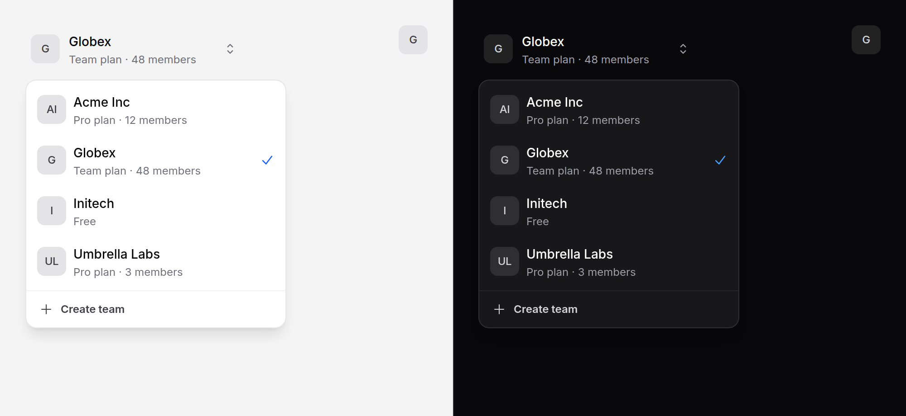

# Team switcher

Switch workspace, team or account: the current one's square avatar, name and
plan on the trigger; a list with a check on the current one; a search field
when the list is long.



> **Needs Alpine** and the package's script for the list. Without them it is a
> native select in a form, or a list of links. See [getting started](../getting-started.md#3-add-the-script).

## Use it

Posting the choice, the moment it is made:

```blade
<x-ds::team-switcher
    :teams="$user->teams->map(fn ($t) => ['id' => $t->id, 'name' => $t->name, 'meta' => $t->plan_name, 'src' => $t->logo_url])"
    :current="$user->current_team_id"
    name="team_id"
    :action="route('current-team.update')"
    method="PUT"
>
    <x-slot:footer>
        <x-ds::button variant="ghost" size="sm" icon="plus" :href="route('teams.create')">Create team</x-ds::button>
    </x-slot:footer>
</x-ds::team-switcher>
```

When every team has its own URL, give each an `href`: choosing one goes there,
and there is no form.

```blade
<x-ds::team-switcher :teams="$teams->map(fn ($t) => ['id' => $t->id, 'name' => $t->name, 'href' => route('teams.show', $t)])" :current="$team->id" />
```

Or bind it, and handle the change yourself:

```blade
<x-ds::team-switcher :teams="$teams" :current="$currentTeamId" wire:model.live="currentTeamId" />

<x-ds::team-switcher :teams="$teams" current="2" name="team" @change="switchTo($event.detail.id)" />
```

`wire:model` and `x-model` go on the select inside, which holds the value in
both forms, and `change` comes from it, bubbling, with `{ id }` in its detail.

## Props and slots

| Prop | Type | Default | What it does |
|---|---|---|---|
| `teams` | array | — | Rows of `id` and `name` (both required), and optionally `meta` (a plan or a role), `src` or `initials` for the avatar, and `href`. At least one. |
| `current` | string\|int | the first | The id of the team in use. |
| `name` | string | — | The field the chosen id posts under. |
| `action` | string | — | A URL: the view draws a form posting there, submitted the moment a team is chosen. |
| `method` | string | `POST` | With `action`: `POST`, or `PUT`, `PATCH`, `DELETE` spoofed with `_method`. |
| `label` | string | `"Switch team"` | What it does: the accessible name of the panel and the list, and the no-script select's label. |
| `searchFrom` | int | `6` | A search field heads the list when there are MORE teams than this. |
| `compact` | bool | `false` | The avatar alone on the trigger, for a collapsed sidebar. |
| `placeholder` | string | `"Find a team…"` | The search field's placeholder and name. |
| `emptyText` | string | `"No teams match"` | Said when the search matches nothing. |
| `submitLabel` | string | `"Switch"` | The no-script form's button. |
| `open` | string | — | An Alpine expression holding the open state, as [popover](popover.md). |

| Slot | What goes in it |
|---|---|
| `footer` | An action under the list: "Create team", "Manage teams". |

Anything else (`id`, `class`, `@change`) goes on the root; `wire:model` and
`x-model` go on the select.

## What it does

- **Choosing a team** sets the select to its id, moves the check and the
  trigger's face to it, closes the panel with focus back on the trigger, and
  dispatches `change`. With `action` it then submits the form. With `href` it
  follows the link instead.
- **Searching** filters as you type, ranked as the
  [command palette](command-palette.md) ranks: a match in the name first, in
  the meta just below. Enter in the field chooses the first match. Each opening
  starts from the whole list.
- **Without the script**, the list is a native select and a Switch button in
  the form (or no button, with no `action`, for a form of your own around it),
  or, when every team has `href`, a list of links with `aria-current` on the
  current one.
- **Under a Livewire morph** it keeps working: the view renders the current
  team from the server, the ids are hashed from the list and not from the
  current team, and the script reads the DOM on every event.

## Accessibility

- The trigger is a button, `aria-haspopup="dialog"` and `aria-expanded`,
  opening a [popover](popover.md) named by `label`. Its name is the current
  team's name and meta, read from the text on it; compact, the same text is
  there, visually hidden.
- The list is a `listbox` of `option`s, `aria-selected` on the current one.
  Focus starts on the search field, or on the current team.

| Key | Where | What it does |
|---|---|---|
| Down Arrow | the field | Into the list, at its first team. |
| Down / Up Arrow | the list | The next or previous team, wrapping; Up from the first goes back to the field. |
| Home / End | the list | The first or the last team. |
| Enter, Space | the list | Choose that team. |
| Enter | the field | Choose the first match. |
| Escape | anywhere | Close, focus back on the trigger. |
| Tab | anywhere | On to the footer, then out. |

## Don't

- **Don't use it for more than switching.** Creating and managing teams are
  pages; link to them from the footer.
- **Don't give some teams an `href` and not others.** It is links or values,
  not both: with any team missing one it is a select.
- **Don't hide the current team from the list.** The check is how someone
  confirms where they are.

More in [specs/team-switcher.md](../../specs/team-switcher.md).
