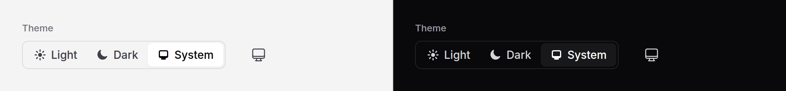

# Theme switcher

Lets the reader pick light, dark, or whatever their system uses. The choice
is remembered in the browser, applied to the whole page, followed by every
other switcher on the page and in other tabs, and, on "system", kept in step
with the system as it changes.



> **Needs Alpine** and the package's script. See [getting started](../getting-started.md#3-add-the-script).
> The theme script below needs neither.

## Use it

Two pieces. The **theme script** goes in the `<head>`, **before your
stylesheet**, so the page is drawn in the right theme from its first frame:

```blade
<head>
    <meta charset="utf-8">
    <x-ds::theme-script />
    @vite(['resources/css/app.css', 'resources/js/app.js'])
    <x-ds::scripts />
</head>
```

It is a few hundred bytes of plain inline JavaScript. It reads the stored
choice and puts `dark` or `light` on `<html>` before CSS paints; anywhere
later, a reader who chose dark sees a flash of light on every page load. Under
a Content Security Policy it takes the nonce you gave Laravel's Vite helper,
or `nonce="…"`.

Then the switcher, wherever the reader changes settings:

```blade
<x-ds::theme-switcher />
```

or, in a header or a toolbar, the compact one:

```blade
<x-ds::theme-switcher variant="button" />
```

## Variants

| Variant | Looks like | Use it for |
|---|---|---|
| `segmented` | Light, Dark, System side by side, a [segmented control](segmented-control.md) | A settings page, an account menu: all three visible, one press each |
| `button` | One icon button that steps Light → Dark → System | A header or a toolbar, where three segments do not fit |
| `menu` | A row inside a menu: the label, then three small icon choices | The `theme` slot of a [user menu](user-menu.md), or any [dropdown](dropdown.md) |

There is no dropdown variant: it would hide three short choices behind an extra
press. `menu` is the other way round: a row for a menu that is already open.

```blade
<x-ds::user-menu :name="$user->name" :signOutAction="route('logout')">
    …
    <x-slot:theme><x-ds::theme-switcher variant="menu" /></x-slot:theme>
</x-ds::user-menu>
```

## Props

### `theme-switcher`

| Prop | Type | Default | What it does |
|---|---|---|---|
| `variant` | string | `segmented` | `segmented`, `button` or `menu`. |
| `storageKey` | string | `ds-theme` | The localStorage key. Give `theme-script` the same one. |
| `label` | string | `Theme` | The segmented control's legend, and the first half of the button's name ("Theme: Dark"). |
| `hideLabel` | bool | `false` | Keep the segmented control's label for screen readers only. |
| `size` | string | `md` | `sm`, `md` or `lg`, as the segmented control and the button. |
| `name` | string | random | The radios' name. Unique per switcher unless you pass one. |
| `transition` | bool | `true` | Crossfade the page into the new theme where the browser supports view transitions and the reader allows motion. |

### `theme-script`

| Prop | Type | Default | What it does |
|---|---|---|---|
| `storageKey` | string | `ds-theme` | The key to read; the switcher's. |
| `nonce` | string | Vite's | The CSP nonce for the script element. |

## What it does

- **Remembers** the choice in localStorage under `storageKey`. "System" is
  remembered by removing the key, so a reader who never chose gets the
  system's theme.
- **Applies** it as a class on `<html>`: `dark`, or `light`, never both and
  never neither, with `color-scheme` to match so scrollbars and form controls
  follow. Every `dark:` utility and every token responds.
- **Follows** the system while on "system": switch your OS to dark and the page
  follows at once.
- **Keeps switchers together**: every switcher on the page with the same key
  shows the same choice, and other open tabs change with it.
- **Crossfades** the page into the new theme in browsers that support view
  transitions, over 200 ms; with reduced motion, or without support, it
  changes at once.

## Accessibility

- The segmented variant is a group of radios named by its label: Tab reaches
  it, arrows choose.
- The button's name says what it is and what it is set to, "Theme: System",
  and changes as you press it.
- The menu variant is three `menuitemradio` items with `aria-checked`, named
  Light, Dark and System: the menu's arrow keys stop on each, and Enter or a
  press chooses and closes the menu.
- All show the system focus ring.

## Limits

- **Until Alpine starts, the switcher shows "System"**, because the server
  cannot read the browser's storage. The page itself is already in the right
  theme, from the theme script.
- **One theme per page.** Two switchers on different keys are two choices for
  one page; the last one used wins.
- **In a form**, the segmented variant's radios post with it, under `name`.

## Don't

- **Don't leave out the theme script, or put it after your CSS.** The page
  flashes the wrong theme on every load.
- **Don't add a theme class to `<html>` yourself** as well; the script and the
  switcher own it.

More in [specs/theme-switcher.md](../../specs/theme-switcher.md).
