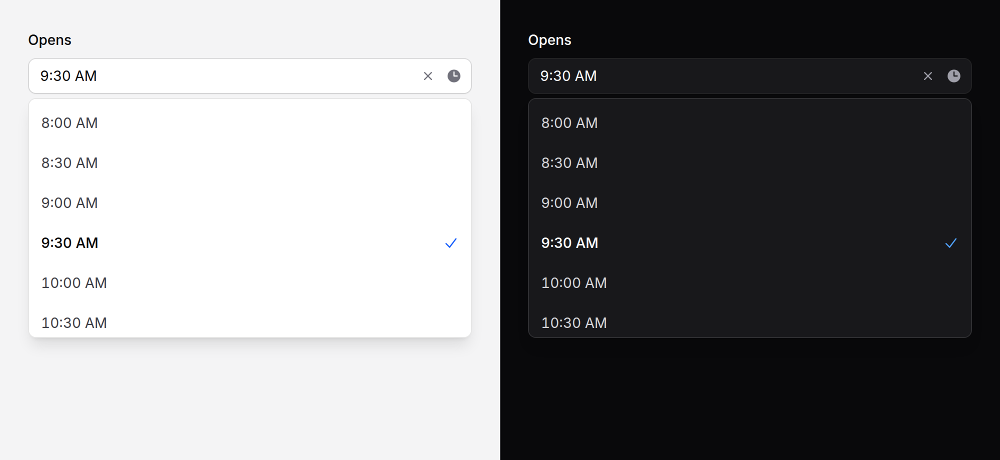

# Time picker

A time of day, typed the way people type times or picked from a list. It
always posts `HH:MM` in 24 hours, whatever it shows.



> **Needs Alpine** and the package's script. See [getting started](../getting-started.md#3-add-the-script).
> Without them it is the browser's own time field, which works everywhere and posts the same value.

## Use it

```blade
<x-ds::time-picker name="starts_at" label="Start" :value="old('starts_at', '09:30')" />

<x-ds::time-picker
    name="opens_at"
    label="Opens"
    :value="old('opens_at')"
    format="12"
    min="08:00"
    max="18:00"
    :step="30"
    placeholder="Choose a time"
    :clearable="true"
/>
```

```php
$request->validate(['opens_at' => ['required', 'date_format:H:i', 'after_or_equal:08:00', 'before_or_equal:18:00']]);
```

## Two modes

**Without the script** it renders a native `<input type="time">` with your
`name`, `min`, `max` and `step`: the browser's own picker and validation, in
every browser, posting `HH:MM`.

**With it** the same field becomes a text field with a list of times under
it. Typing is forgiving: `9`, `930`, `9:30`, `9.30pm` and `21:30` all read,
and leaving the field writes the time back the way the list shows it. Text
that is not a time, or a time outside `min` and `max` or off the step, is
**kept as typed** and marked invalid, so the reader can see and fix it; it is
never quietly changed into some other time. The form does not submit while
it is invalid, as a native time field would not.

## Props

| Prop | Type | Default | What it does |
|---|---|---|---|
| `name` | string | *required* | Submitted name. Always posts `HH:MM`, or nothing. |
| `label` | string | — | Field label; also names the list. |
| `help` | string | — | Guidance under the field. |
| `error` | string | — | Validation message. Replaces `help`. |
| `value` | `HH:MM` \| DateTimeInterface | — | Seconds are dropped; anything that is not a time is ignored. |
| `min` | `HH:MM` | — | The earliest time. The list starts here. |
| `max` | `HH:MM` | — | The latest. Must be later than `min`. |
| `step` | int (minutes) | `15` | The list's interval, and the steps a time must fall on, counted from `min`. |
| `format` | `24` \| `12` | `24` | How times are SHOWN. Posting is always 24-hour. |
| `placeholder` | string | — | Shown in the empty field once the script has taken it over. |
| `clearable` | bool | `false` | A ✕ that empties the field. |
| `disabled` | bool | `false` | |
| `size` | `md` `sm` | `md` | As [input](input.md). |

`wire:model` and `x-model` go on the component and bind the `HH:MM` string.
Anything else goes on the wrapper; a committed change dispatches `input` and
`change` that bubble to it.

```blade
<x-ds::time-picker name="reminder" label="Remind me at" wire:model="reminder" :value="$reminder" format="12" />
```

## A date and a time

There is no combined field. Put the two side by side, posting two values, and
join them on the server:

```blade
<div class="grid grid-cols-[1fr_auto] gap-3">
    <x-ds::date-picker name="due_date" label="Due" :value="old('due_date')" />
    <x-ds::time-picker name="due_time" label="Time" :value="old('due_time')" class="w-36" />
</div>
```

```php
$due = Carbon::parse($request->input('due_date').' '.$request->input('due_time'));
```

They are drawn to sit together: the same label, height, border and a trailing
icon in the same place.

## Accessibility

- With the script it is the ARIA combobox ds::combobox is: the field has
  `role="combobox"`, ArrowDown opens the list and moves focus to the chosen
  time (or the nearest to what is typed), the arrows, Home and End move,
  Enter picks, Escape closes it and returns to the field.
- The chosen time is `aria-selected` in the list and carries a ✓.
- An invalid entry sets `aria-invalid`; `error` also describes the field with
  its message.
- Without the script, everything is the native time field's.

## Don't

- **Don't post what it shows.** Read `HH:MM` on the server; the shown text is
  12-hour, in English.
- **Don't use it for a duration.** "1:30" of work is not half past one.
- **Don't span midnight.** `min` must be earlier than `max`.
- **Don't trust `min`, `max` and `step`.** Validate on the server.

More in [specs/time-picker.md](../../specs/time-picker.md).
