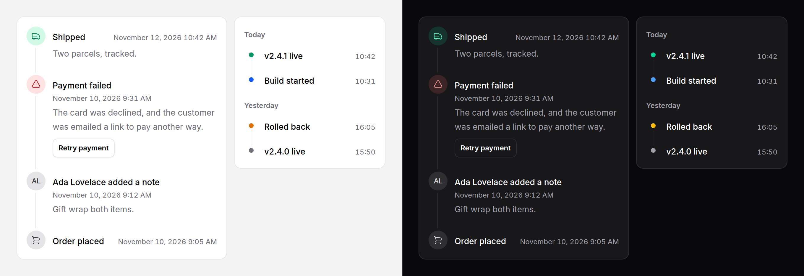

# Timeline

Events in order, joined by a rail: an order's history, an audit log, an
activity feed. Each entry has a time, a title, an optional body and actions,
and a marker: an icon, an avatar or a dot. Groups put a sticky heading over
a run of entries. Plain Blade and CSS; no JavaScript.



## Use it

```blade
<x-ds::timeline label="Order 1042">
    <x-ds::timeline-item title="Shipped" :time="$order->shipped_at" icon="truck" tone="success">
        Two parcels, tracked.
    </x-ds::timeline-item>

    <x-ds::timeline-item title="Payment failed" :time="$failure->at" icon="exclamation-triangle" tone="danger">
        The card was declined.
        <x-slot:actions>
            <x-ds::button size="sm" variant="secondary" wire:click="retry">Retry payment</x-ds::button>
        </x-slot:actions>
    </x-ds::timeline-item>

    <x-ds::timeline-item title="Ada Lovelace added a note" avatar="Ada Lovelace" :time="$note->created_at" :href="route('notes.show', $note)">
        {{ $note->body }}
    </x-ds::timeline-item>
</x-ds::timeline>
```

Grouped, and dense for a side panel:

```blade
<x-ds::timeline label="Deploys" :dense="true">
    @foreach ($deploys->groupBy(fn ($d) => $d->at->isToday() ? 'Today' : $d->at->isoFormat('LL')) as $day => $items)
        <x-ds::timeline-group :label="$day">
            @foreach ($items as $deploy)
                <x-ds::timeline-item :title="$deploy->summary" :time="$deploy->at" time-format="H:i" :tone="$deploy->tone" />
            @endforeach
        </x-ds::timeline-group>
    @endforeach
</x-ds::timeline>
```

## Props

### timeline

| Prop | Type | Default | What it does |
|---|---|---|---|
| `label` | string | — | Names the list for a screen reader. |
| `dense` | bool | `false` | Smaller markers and less space between entries. |

### timeline-item

| Prop | Type | Default | What it does |
|---|---|---|---|
| `time` | DateTime, string | — | A date object or an ISO 8601 string is formatted and written as `<time datetime>`. Any other string ("Yesterday") is shown as written. |
| `datetime` | DateTime, string | — | The machine-readable moment for a `time` given in words. |
| `timeFormat` | string | the locale's date and time | `relative` ("3 hours ago", the full date on hover), or a PHP date format. |
| `title` | string | — | What happened, in one line. |
| `href` | string | — | Makes the title a link. |
| `icon` | string | — | A Heroicon for the marker. |
| `tone` | `neutral` `accent` `success` `warning` `danger` | `neutral` | The marker's colour. |
| `avatar` | string or array | — | A person as the marker: a name, or [avatar's](avatar.md) props (`['name' => …, 'src' => …]`). |

| Slot | What it does |
|---|---|
| default | The body, under the title. Long words and URLs wrap. |
| `actions` | Buttons or links under the body. |

The marker is the avatar if there is one, otherwise the icon, otherwise a dot.

### timeline-group

| Prop | Type | Default | What it does |
|---|---|---|---|
| `label` | string | required | The heading: "Today", "12 November", "Release 2.0". |
| `level` | int, 2 to 6 | `3` | The heading level, to fit the page's outline. |

## Sticky headings and backgrounds

A group's heading sticks to the top of the scrolling box while its entries
pass under it, so it has a background: the surface. On another colour, set
`--ds-timeline-bg` on the timeline or any ancestor; the markers use it too,
for the gap where the rail meets them. Under a sticky page header, set
`--ds-timeline-top` to the header's height:

```blade
<x-ds::timeline class="[--ds-timeline-bg:var(--color-surface-subtle)] [--ds-timeline-top:4rem]">
```

## Load more, with Livewire

Keep one timeline and append pages to it. The rail joins the new entries to
the old ones by itself, because an entry is only "last" until more arrive.

```php
class OrderHistory extends Component
{
    public Order $order;
    public int $perPage = 20;

    public function loadMore(): void
    {
        $this->perPage += 20;
    }

    public function render()
    {
        $events = $this->order->events()->latest()->take($this->perPage + 1)->get();

        return view('livewire.order-history', [
            'events' => $events->take($this->perPage),
            'more' => $events->count() > $this->perPage,
        ]);
    }
}
```

```blade
{{-- livewire/order-history.blade.php --}}
<div>
    <x-ds::timeline label="Order history">
        @foreach ($events as $event)
            <x-ds::timeline-item wire:key="event-{{ $event->id }}"
                :title="$event->title" :time="$event->created_at" time-format="relative"
                :icon="$event->icon" :tone="$event->tone">{{ $event->body }}</x-ds::timeline-item>
        @endforeach
    </x-ds::timeline>

    @if ($more)
        <x-ds::button variant="secondary" size="sm" class="mt-4" wire:click="loadMore">Load more</x-ds::button>
    @endif
</div>
```

`wire:key` keeps each entry the same element across the morph, so focus on a
link or an action survives a page arriving.

## Accessibility

- An ordered list, named by `label`; a group is an entry holding a heading
  and its own list, so a screen reader announces both.
- The markers are hidden from assistive technology: the icon, the dot and the
  avatar repeat the title, and the tone is only a colour. **The title must say
  what happened**: "Payment failed", including the person when there is an
  avatar.
- Times are `<time datetime>` wherever the moment is known.
- Nothing is focusable but what you put in: the title's link and the actions.

## Don't

- **Don't let the tone carry the meaning.** A red dot says nothing to a
  screen reader, or to anyone who cannot tell red from grey.
- **Don't use it for steps still to come.** A sequence of states with a
  current one is a [stepper](stepper.md).
- **Don't reverse it with CSS.** Sort the data; the list order is what is read.
- **Don't nest timelines.** One level of groups is the structure.

More in [specs/timeline.md](../../specs/timeline.md).
