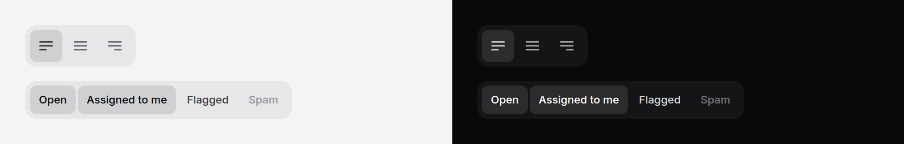

# Toggle group

Buttons that stay pressed. `single` is one of several, like text alignment;
`multiple` is any of several, like bold and italic. With a `name`, the group
posts like the radios or checkboxes it stands in for.



> **Needs Alpine** and the package's script. See [getting started](../getting-started.md#3-add-the-script).

## Use it

One of several:

```blade
<x-ds::toggle-group label="Alignment" name="align">
    <x-ds::toggle value="left" icon="bars-3-bottom-left" label="Left" :iconOnly="true" :pressed="$align === 'left'" />
    <x-ds::toggle value="center" icon="bars-3" label="Center" :iconOnly="true" :pressed="$align === 'center'" />
    <x-ds::toggle value="right" icon="bars-3-bottom-right" label="Right" :iconOnly="true" :pressed="$align === 'right'" />
</x-ds::toggle-group>
```

The request carries `align=center`.

Any of several, posting `filters[]`:

```blade
<x-ds::toggle-group label="Filters" type="multiple" name="filters">
    @foreach ($filters as $key => $words)
        <x-ds::toggle :value="$key" :label="$words" :pressed="in_array($key, old('filters', $active))" />
    @endforeach
</x-ds::toggle-group>
```

Leave `name` out and nothing posts: the group is then only state for the page
(see binding, below).

Inside a [toolbar](toolbar.md), the toggles join the toolbar's single Tab
stop, its arrow keys and its highlight, and take its size.

## Livewire and Alpine

Put the binding on the group. `single` binds a string (`''` when none is
pressed), `multiple` an array of the pressed values in the order they appear:

```blade
<x-ds::toggle-group label="Text style" type="multiple" wire:model.live="marks">
    <x-ds::toggle value="bold" icon="bold" label="Bold" :iconOnly="true" :pressed="in_array('bold', $marks)" />
    <x-ds::toggle value="italic" icon="italic" label="Italic" :iconOnly="true" :pressed="in_array('italic', $marks)" />
</x-ds::toggle-group>
```

Setting the property from code presses and releases the toggles to match.
Each press also dispatches `input` and `change` from the toggle, for
`@change` listeners.

## Props

`ds::toggle-group`:

| Prop | Type | Default | What it does |
|---|---|---|---|
| `label` | string | — | What the toggles set ("Alignment", "Text style"). The group's accessible name. Required. |
| `type` | string | `single` | `single` (one pressed at a time, radio semantics) or `multiple` (any, each a pressed button). Anything else throws. |
| `name` | string | — | Posts the pressed values through hidden inputs; `[]` is added for `multiple`. |
| `size` | string | `md` | `sm` (32px) or `md` (36px). Inside a toolbar, the toolbar's unless set here. |

`ds::toggle`:

| Prop | Type | Default | What it does |
|---|---|---|---|
| `value` | string | — | What the toggle stands for, and posts while pressed. Required. |
| `label` | string | — | The words, and the accessible name. Required. |
| `icon` | string | — | A Heroicons name, drawn before the words. |
| `iconOnly` | bool | `false` | Square, the icon alone; `label` stays the name. Needs `icon`. |
| `pressed` | bool | `false` | Pressed on the first paint. |
| `disabled` | bool | `false` | Cannot be pressed, and does not post. |
| `tooltip` | string, bool | — | A [tooltip](tooltip.md): the text, or `true` for the label. |

## What it does

- **Single:** pressing a toggle presses it and releases the other. Pressing
  the one already pressed keeps it; there is always a choice once one is made.
- **Multiple:** each press flips that toggle.
- **The state is rendered from PHP.** `pressed` draws the face and sets the
  hidden input before any script, so the first paint is right.
- **Posting:** only pressed, enabled toggles post. A disabled toggle never
  does, pressed or not, as a disabled checkbox would not.
- **On its own** the group is one Tab stop, with the arrow keys moving between
  toggles (either axis, wrapping, skipping disabled) and Home and End. In
  `single` the arrows also press, as radios do. Inside a toolbar, the toolbar's
  keys apply and Space or Enter presses.
- **A highlight** follows the pointer and keyboard focus, as in a toolbar.

## Accessibility

- `single`: `role="radiogroup"` named by `label`, each toggle `role="radio"`
  with `aria-checked`.
- `multiple`: `role="group"` named by `label`, each toggle a button with
  `aria-pressed`.
- Pressed shows as a filled face, not by colour alone.
- Icon-only toggles keep `label` as visually hidden text; add `:tooltip="true"`.

## Don't

- **Don't use it for actions.** A toggle sets a state; a
  [button group](button-group.md) runs commands.
- **Don't use `single` to switch views.** That is a
  [segmented control](segmented-control.md), which works without script.
- **Don't use it for a long list.** A [chip group](chip-group.md) wraps; a
  toggle group stays on one line.
- **Don't drop `pressed` and rely on the script.** The page should be right
  before it runs.

More in [specs/toggle-group.md](../../specs/toggle-group.md).
