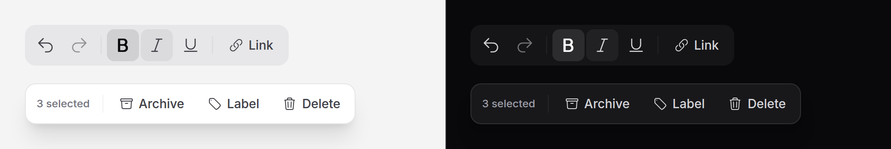

# Toolbar

A row of tools that is one stop in the Tab order: text formatting over an
editor, the actions for a selection, a tool palette. The arrow keys move
between its buttons, and a soft highlight follows the pointer and the keyboard
from one to the next.



> **Needs Alpine** and the package's script. See [getting started](../getting-started.md#3-add-the-script).

## Use it

```blade
<x-ds::toolbar label="Formatting">
    <x-ds::toolbar-button icon="arrow-uturn-left" label="Undo" :iconOnly="true" :tooltip="true" wire:click="undo" />
    <x-ds::toolbar-button icon="arrow-uturn-right" label="Redo" :iconOnly="true" :tooltip="true" :disabled="! $canRedo" wire:click="redo" />
    <x-ds::toolbar-separator />
    <x-ds::toolbar-button icon="link" label="Link" wire:click="addLink" />
</x-ds::toolbar>
```

A floating tray over content, for the actions on what is selected:

```blade
<x-ds::toolbar label="{{ count($selected) }} selected" variant="floating" size="sm">
    <x-ds::toolbar-button icon="archive-box" label="Archive" wire:click="archive" />
    <x-ds::toolbar-button icon="trash" label="Delete" wire:click="delete" />
</x-ds::toolbar>
```

Position it yourself (`class="fixed inset-x-0 bottom-6 mx-auto w-fit"`); the
toolbar only draws the tray.

### Buttons that stay pressed

`pressed` makes a toolbar button a toggle button: `true` or `false` renders
`aria-pressed`, and the button shows the pressed face. The toolbar does not
flip it; the host does, from its own state:

```blade
<x-ds::toolbar-button icon="star" label="Star" :pressed="$post->starred" wire:click="toggleStar" />
```

In Alpine, bind the attribute: `:aria-pressed="starred"`.

For a set of toggles that hold their own state and post it, put a
[toggle group](toggle-group.md) inside the toolbar. Its toggles join the
toolbar's arrow keys and its highlight:

```blade
<x-ds::toolbar label="Formatting">
    <x-ds::toggle-group label="Text style" type="multiple" name="marks">
        <x-ds::toggle value="bold" icon="bold" label="Bold" :iconOnly="true" />
        <x-ds::toggle value="italic" icon="italic" label="Italic" :iconOnly="true" />
    </x-ds::toggle-group>
    <x-ds::toolbar-separator />
    <x-ds::toolbar-button icon="link" label="Link" />
</x-ds::toolbar>
```

## Props

`ds::toolbar`:

| Prop | Type | Default | What it does |
|---|---|---|---|
| `label` | string | — | What the toolbar is for ("Formatting", "3 selected"). Its accessible name. Required. |
| `variant` | string | `muted` | `muted`, a tinted tray in the page; or `floating`, a hairline and the overlay shadow, for a tray over content. |
| `size` | string | `md` | `sm` (32px) or `md` (36px), for every button in it. |
| `orientation` | string | `horizontal` | `horizontal` or `vertical`: which arrow keys move, and which way it lays out. |

`ds::toolbar-button`:

| Prop | Type | Default | What it does |
|---|---|---|---|
| `label` | string | — | The words, and the accessible name. Required. |
| `icon` | string | — | A Heroicons name, drawn before the words. |
| `iconOnly` | bool | `false` | Square, the icon alone; `label` stays the name. Needs `icon`. |
| `pressed` | bool, null | `null` | `true`/`false` makes it a toggle button with `aria-pressed`; `null` a plain button. Rendered, not managed. |
| `disabled` | bool | `false` | Greyed and skipped by the arrow keys. |
| `href` | string | — | A link instead of a button. Cannot be combined with `pressed`. |
| `tooltip` | string, bool | — | A [tooltip](tooltip.md) on hover and focus: the text, or `true` for the label. Mostly for `iconOnly`. |

Anything else (`wire:click`, `@click`, `type="submit"`, `form`) goes on the
button.

`ds::toolbar-separator` has no props: a rule between sets of buttons, drawn
across the toolbar's direction.

## What it does

- **One Tab stop.** Tab lands on the last button used (the first, at first)
  and Tab again leaves the toolbar.
- **Arrow keys** move between buttons, Left and Right in a horizontal toolbar
  (mirrored on right-to-left pages), Up and Down in a vertical one. They wrap
  at the ends and skip disabled buttons. Home and End jump to the first and
  last.
- **The highlight** follows the pointer over the buttons, over 150 ms, and
  holds still over the gaps between them; it fades when the pointer leaves.
  Keyboard focus moves it too. Touch does not, since a finger has no hover.
- **Pressing** darkens the highlight and shrinks it slightly; the button itself
  never moves, so its words stay put. With reduced motion the highlight jumps
  and only fades.

## Accessibility

- `role="toolbar"` named by `label`, with `aria-orientation`.
- One Tab stop with roving focus, as the ARIA toolbar pattern describes.
- Icon-only buttons keep `label` as visually hidden text; add `:tooltip="true"`
  so sighted users can find it too.
- `pressed` is `aria-pressed`, shown by a filled face as well as colour.
- A disabled button is `disabled` (a disabled link `aria-disabled`, without
  `href`).

## Don't

- **Don't put fields in a toolbar.** Inputs and selects need the arrow keys for
  themselves; put them beside it.
- **Don't use one for a few page actions.** Separate [buttons](button.md), or a
  [button group](button-group.md), each a Tab stop, are easier to find.
- **Don't flip `pressed` in the toolbar's markup by hand** without changing
  your state: what it renders is what is true.
- **Don't nest toolbars.** A toggle group is the one group that belongs inside.

More in [specs/toolbar.md](../../specs/toolbar.md).
