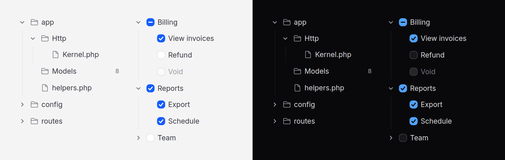

# Tree

Nested items that open and close: a file browser, a docs sidebar, a set of
permissions to grant. Covers `tree` and `tree-item`.



> **Needs Alpine** and the package's script. See [getting started](../getting-started.md#3-add-the-script).
> Without them the tree is drawn as PHP rendered it (open folders, the
> selection, the boxes, every link) and posts what it shows; it does not open,
> close or choose.

## Use it

Nest items inside items:

```blade
<x-ds::tree label="Files">
    <x-ds::tree-item label="app" icon="folder" :open="true">
        <x-ds::tree-item label="Http" icon="folder">
            <x-ds::tree-item label="Kernel.php" icon="document" />
        </x-ds::tree-item>
        <x-ds::tree-item label="helpers.php" icon="document" />
    </x-ds::tree-item>
    <x-ds::tree-item label="composer.json" icon="document" />
</x-ds::tree>
```

## A navigation tree

Give the items an `href`. `selected` marks the current page
(`aria-current="page"`), and every folder above it opens:

```blade
<x-ds::tree label="Documentation">
    <x-ds::tree-item label="Guides" href="/docs/guides">
        <x-ds::tree-item label="Install" href="/docs/install" :selected="request()->is('docs/install')" />
        <x-ds::tree-item label="Upgrade" href="/docs/upgrade" :selected="request()->is('docs/upgrade')" />
    </x-ds::tree-item>
</x-ds::tree>
```

A press on a folder's chevron opens it; a press on its words follows its link.

## Choose one

```blade
<x-ds::tree label="Move to" selectable="single" name="folder">
    <x-ds::tree-item label="Inbox" value="inbox">
        <x-ds::tree-item label="Receipts" value="receipts" :selected="$folder === 'receipts'" />
    </x-ds::tree-item>
    <x-ds::tree-item label="Archive" value="archive" />
</x-ds::tree>
```

Posts `folder=receipts`, from one hidden input.

## Check many

```blade
<x-ds::tree label="Permissions" selectable="multiple" name="permissions">
    <x-ds::tree-item label="Billing" value="billing" :open="true">
        <x-ds::tree-item label="View invoices" value="billing.view" :selected="$role->can('billing.view')" />
        <x-ds::tree-item label="Refund" value="billing.refund" :selected="$role->can('billing.refund')" />
    </x-ds::tree-item>
</x-ds::tree>
```

A parent's box is worked out from its leaves: all, some (a dash) or none.
Checking a parent checks every enabled leaf under it. Only **leaves** post, as
`permissions[]`; a parent is a way to check many, not a value of its own.

## `tree` props

| Prop | Type | Default | What it does |
|---|---|---|---|
| `label` | string | *required* | What the tree holds. Its accessible name. |
| `selectable` | `none` \| `single` \| `multiple` | `none` | `multiple` draws a checkbox on every row. |
| `name` | string | — | The field it posts as: one input for `single`, `name[]` per checked leaf for `multiple`. |

`wire:model` and `x-model` go on the tree: a string for `single`, an array of
leaf values for `multiple`.

## `tree-item` props

| Prop | Type | Default | What it does |
|---|---|---|---|
| `label` | string | *required* | The row's words. |
| `icon` | string | — | A Heroicons name before the words. |
| `href` | string | — | Makes it a link. Not in a selectable tree (it throws). |
| `open` | bool | the current page or selection is inside | Whether its children show. |
| `selected` | bool | `false` | Selected, checked, or the current page, by the tree's kind. |
| `disabled` | bool | `false` | Can be focused and opened, never chosen or followed. |
| `value` | string | the label | What it posts, and what its events carry. |
| `count` | int\|string | — | A number after the words. |
| `expandable` | bool | `false` | A folder with nothing in it yet, for children you load on `expand`. |

The `badge` slot takes anything in place of `count`:

```blade
<x-ds::tree-item label="Inbox">
    <x-slot:badge><x-ds::badge tone="accent">3 new</x-ds::badge></x-slot:badge>
</x-ds::tree-item>
```

## Events

`expand` and `collapse`, bubbling, with `{ value }`, when the reader opens or
closes a folder.

## Load children when a folder opens (Livewire)

Draw the folder `expandable`, listen for `expand`, and render its children once
they are loaded. The tree counts the new rows and keeps its one Tab stop.

```blade
{{-- public array $loaded = []; --}}
<x-ds::tree label="Files" x-on:expand="$wire.load($event.detail.value)">
    @foreach ($folders as $folder)
        <x-ds::tree-item :label="$folder->name" :value="$folder->id" icon="folder"
            :expandable="true" :open="isset($loaded[$folder->id])"
            wire:key="folder-{{ $folder->id }}">
            @foreach ($loaded[$folder->id] ?? [] as $file)
                <x-ds::tree-item :label="$file->name" :value="$file->id" icon="document" />
            @endforeach
        </x-ds::tree-item>
    @endforeach
</x-ds::tree>
```

```php
public function load(string $id): void
{
    $this->loaded[$id] ??= File::where('folder_id', $id)->get(['id', 'name'])->all();
}
```

Pass `:open` from what is loaded, so the re-render keeps the folder open.

## Keyboard

| Key | Does |
|---|---|
| ↓ ↑ | Next / previous row |
| → | Opens a folder; on an open one, moves into it |
| ← | Closes a folder; otherwise moves to its parent |
| Home / End | First / last row |
| A letter | The next row starting with it |
| `*` | Opens every folder beside this one |
| Enter | Follows a link, selects, checks, or opens and closes |
| Space | The same, except on a link |

## Accessibility

- The WAI-ARIA tree pattern: `role="tree"`, `treeitem`, `group`, with
  `aria-level`, `aria-setsize` and `aria-posinset` rendered by PHP.
- One Tab stop for the whole tree; the arrows move inside it.
- Selection and the current page are shown with weight as well as colour.

## Don't

- **Don't mix links and choosing in one tree.** It throws.
- **Don't use a tree for one level.** That is a list, a select or radio cards.
- **Don't use it for actions.** A tree holds things; commands are a dropdown.
- **Don't nest past four levels.** Give a deep branch a page of its own.

More in [specs/tree.md](../../specs/tree.md), including how the structure is
counted before any script runs.
