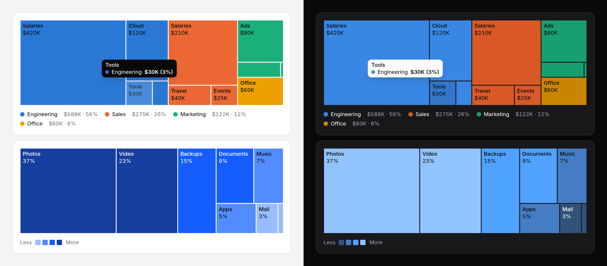

# Treemap

Parts of a whole as rectangles sized by value (storage by folder, spend by
team), optionally grouped one level deep. Laid out in PHP, static SVG, with
a generated summary and every tile in a visually hidden table.



> **Needs Alpine** and the package's script for the readout and keyboard
> access to each tile. Without them the treemap is a correct static image
> with a generated text alternative and its table, and linked tiles are
> plain links. See [getting started](../getting-started.md#3-add-the-script).

## When to use it

For many parts of one whole where the big ones should stand out and the
small ones only need to be findable: a dozen to a few dozen tiles, or a few
groups of them. Areas are read roughly, so to compare parts of similar size
use a [bar chart](bar-chart.md); for two to eight parts a
[donut](donut-chart.md) or a [split bar](split-bar.md) is plainer.

## Use it

```blade
{{-- Parts of a whole --}}
<x-ds::treemap label="Storage" :format="['suffix' => ' GB']"
    :data="['Photos' => 150, 'Video' => 96, 'Backups' => 60, 'Documents' => 38, 'Music' => 30]" />

{{-- Groups: a colour per group, its parts inside it --}}
<x-ds::treemap label="Spend by team" :format="['prefix' => '$', 'compact' => true]" :data="[
    ['label' => 'Engineering', 'children' => ['Salaries' => 420000, 'Cloud' => 120000, 'Tools' => 30000]],
    ['label' => 'Sales', 'children' => ['Salaries' => 210000, 'Travel' => 40000]],
    ['label' => 'Office', 'value' => 60000],
]" />

{{-- One hue by value, shares on the tiles, each tile a link --}}
<x-ds::treemap label="Pages by views" colourBy="value" showValues="percent" :data="$pages->map(fn ($p) => [
    'label' => $p->title, 'value' => $p->views, 'href' => route('pages.show', $p),
])" />
```

## Props

| Prop | Type | Default | What it does |
|---|---|---|---|
| `data` | array | — | `['Photos' => 150, …]`, or rows with `label`, `value`, an optional `tone` or `series` and an optional `href`. A row with `children` (rows of the same shape) is a group, its value the sum of theirs; one level only, deeper throws. A non-number throws; zero or less is left out (see below). |
| `label` | string | — | What the whole is; the start of the summary and the table's caption. |
| `colourBy` | `series` `value` | `series` | A series colour per top-level part (eight at most, more throws), its children sharing it; or one hue in four steps by value. |
| `tone` | `neutral` `accent` `success` `warning` `danger` | `accent` | The hue of `colourBy="value"`. |
| `showValues` | `value` `percent` `none` | `value` | The second line of a tile's label, on tiles at least 40px tall. |
| `minLabel` | int, px | `40` | Tiles narrower or shorter than this carry no label; the readout and the table still have them. |
| `height` | `sm` `md` `lg` | `md` | 192, 256 or 320px. |
| `ratio` | number, 0.5 to 6 | `2` | The width the layout is shaped for, as a multiple of the height. Set it near the space the chart usually gets: in a wider box every tile is stretched the same way. |
| `legend` | bool | `true` | With groups, each group's colour, total and share; with `colourBy="value"`, the four steps from less to more. |
| `format` | array | `[]` | How values read; [counter's keys](counter.md#format). |
| `summary` | string | generated | The text alternative, in place of the generated one. |
| `table` | bool | `true` | Every tile as a visually hidden table, the unlabelled ones included. |
| `interactive` | bool | `true` | With the script: the readout and keyboard access. |
| `empty` | string | `No data to show` | The empty state's title, when nothing is above zero. |

**Zero and negative values** have no area, so they are not drawn and not in
the total the shares are taken of. They are still listed in the table as
"not drawn", and the summary counts them. Equal values keep the order you
gave them, so the same data always lays out the same way.

A label is cut to its tile and hidden while the chart is too narrow for it;
its text colour is whichever of near-black and white reads better on that
fill, in each theme (at least 4.5:1 on every fill the treemap draws).

## Accessibility

- Without the script the treemap is `role="img"`: "Storage: 5 parts, total
  374 GB; the largest is Photos at 40%." With groups it adds the largest
  tile: "… 6 tiles; the largest is Salaries in Engineering at 48%." The
  table lists every tile.
- With it, one Tab stop; the arrows move tile to tile, largest first, Home
  and End to the ends, Escape puts the readout away. Each tile is named
  "Salaries, Engineering: $420K (48%)", so the smallest tile is as easy to
  read as the largest.
- **With links**, every linked tile is a link with its own Tab stop, with
  the script or without, and focusing one shows its readout; the arrow keys
  do not move between them. The focus ring is drawn inside the tile.
- There is no zoom or drill-down. Link a tile to a page of its own instead.

## Don't

- **Don't compare similar values with it.** Areas are read roughly.
- **Don't nest more than one level.** It throws.
- **Don't give every leaf its own colour.** The colour is the group; with no
  groups and more than eight parts, use `colourBy="value"`.

More in [specs/treemap.md](../../specs/treemap.md).
