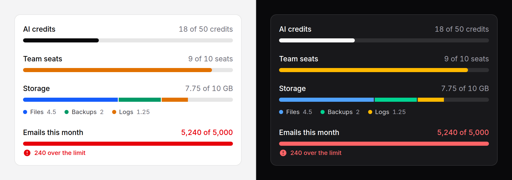

# Usage meter

An allowance and how much of it is used: credits, seats, storage. Optionally
broken down by what fills it.



## Use it

```blade
<x-ds::usage-meter label="AI credits" :used="$team->credits_used" :limit="$plan->credits" unit="credits" />
```

With a breakdown:

```blade
<x-ds::usage-meter label="Storage" :limit="10" unit="GB" :segments="[
    ['label' => 'Files', 'value' => 4.5, 'tone' => 'accent'],
    ['label' => 'Backups', 'value' => 2, 'tone' => 'success'],
    ['label' => 'Logs', 'value' => 1.25, 'tone' => 'warning'],
]" />
```

## Props

| Prop | Type | Default | What it does |
|---|---|---|---|
| `label` | string | — | What is being used up. The heading, and the accessible name. Required. |
| `used` | number | the sum of `segments`, else `0` | How much is used. May exceed `limit`. |
| `limit` | number | — | The allowance. Required. |
| `unit` | string | — | The noun after the numbers: `credits` reads "42 of 50 credits". |
| `warnAt` | number | `80` | Percent of `limit` at which the bar turns `warning`. |
| `dangerAt` | number | `100` | Percent of `limit` at which it turns `danger`. |
| `segments` | array | — | A stacked bar with a legend: a list of `label`, `value`, `tone` (`neutral` `accent` `success` `warning` `danger`; default `neutral`). Arrays or objects. |

Numbers print with thousands separators and without trailing zeros: `1,200`,
`1.5`. The formatting is English; for another locale, pass numbers you have
already rounded and a `unit` in that language.

## Thresholds

Below `warnAt` the bar is neutral. From `warnAt` it is `warning`, from
`dangerAt` `danger`. **At** the limit is danger, because the next use is
refused; **over** it is said in words as well:

> **240 over the limit**, under the bar, with an icon, in `danger`.

The bar never overflows. Over the limit a single bar is simply full.

With `segments`, each segment keeps its own tone and the thresholds only
colour the over-limit message; when the segments add up to more than the
limit they are scaled down together, so they still fill the track exactly and
keep their proportions to each other.

A `limit` of `0` renders rather than throwing (a plan with none of something):
nothing used is empty, anything used is over.

## When to use which

| | Use it for | Example |
|---|---|---|
| [Progress](progress.md) | A task moving towards done | Uploading, 64% |
| **Usage meter** | An allowance being used up, in its units | 42 of 50 credits |
| [Gauge](gauge.md) | A reading that goes up and down within a range | CPU at 42% |

A usage meter is for something that is **spent**: the reader wants the units,
and how many are left.

## Accessibility

- The bar is `role="meter"`, named by `label`, with `aria-valuemin="0"`,
  `aria-valuemax` = `limit` and `aria-valuenow` = `used`, capped at the limit
  because a meter's value has to sit inside its range.
- `aria-valuetext` carries the words actually read: "42 of 50 credits", or
  "1,200 of 1,000 MB, 200 MB over the limit".
- The legend is a real list, readable by everyone. The coloured dots are
  decorative; every segment is named in text.
- Over the limit is stated in words, never by colour alone.

## Don't

- **Don't use it for a task.** Something moving towards done is a
  [progress](progress.md) bar.
- **Don't pass a percentage as `used`.** Pass the real numbers; the component
  does the arithmetic and the reader sees units, not a ratio.
- **Don't colour segments by threshold.** A segment's tone says what it is, not
  how full the whole is.
- **Don't use more than about five segments.** Past that the legend wraps and
  the thin ones disappear; group the small ones as "Other".

More in [specs/usage-meter.md](../../specs/usage-meter.md).
