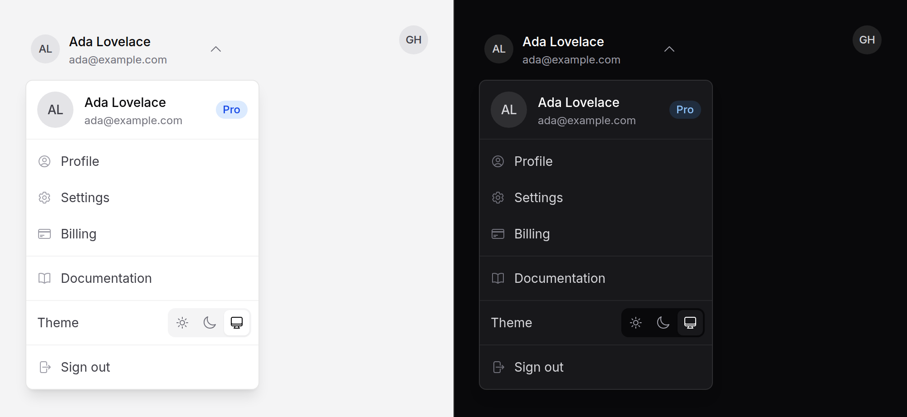

# User menu

The account menu in an app shell: the signed-in person's avatar, a header
that says who they are, your items, a theme row, and sign-out.



> **Needs Alpine.** It is a [dropdown](dropdown.md). See [getting started](../getting-started.md#3-add-the-script).

## Use it

```blade
<x-ds::user-menu
    :name="$user->name"
    :email="$user->email"
    :src="$user->avatar_url"
    :plan="$team->plan_name"
    :signOutAction="route('logout')"
>
    <div role="group" aria-label="Account">
        <x-ds::dropdown-item :href="route('profile')" icon="user-circle">Profile</x-ds::dropdown-item>
        <x-ds::dropdown-item :href="route('settings')" icon="cog-6-tooth">Settings</x-ds::dropdown-item>
    </div>
    <div role="group" aria-label="Help">
        <x-ds::dropdown-item href="/docs" icon="book-open">Documentation</x-ds::dropdown-item>
    </div>

    <x-slot:theme>
        <x-ds::theme-switcher variant="menu" />
    </x-slot:theme>
</x-ds::user-menu>
```

The items are ordinary [dropdown items](dropdown.md). Wrap related ones in
`<div role="group" aria-label="…">` and each group after the first is parted
from the one before it by a hairline; a plain list of items needs no wrapper.

For a narrow header or a collapsed sidebar, `:compact="true"` shows the avatar
alone.

## Props and slots

| Prop | Type | Default | What it does |
|---|---|---|---|
| `name` | string | — | Required. Shown on the trigger and in the header, and the compact trigger's accessible name. |
| `email` | string | — | Under the name, in the header and on the trigger. |
| `meta` | string | `email` | The trigger's second line instead, a role or a team: "Admin · Acme". |
| `src` | string | — | The avatar image. Without it, initials. |
| `initials` | string | — | Initials of your own, instead of the first and last word of `name`. |
| `plan` | string | — | A badge in the header: "Pro", "Trial". |
| `compact` | bool | `false` | The avatar alone on the trigger. |
| `align` | string | `end` | `start` or `end`: which edge of the trigger the panel lines up with. It opens below, and above when there is no room. |
| `signOutAction` | string | — | The URL sign-out POSTs to. Without it there is no sign-out item. |
| `signOutLabel` | string | `"Sign out"` | Its words. |
| `open` | string | — | An Alpine expression holding the open state, as [dropdown](dropdown.md). |

| Slot | What goes in it |
|---|---|
| default | Your items, in groups or not. |
| `theme` | A row under the items, made for `<x-ds::theme-switcher variant="menu" />`. |
| `csrf` | The sign-out form's token field, when it is not the session's `csrf_token()`. Left out, the view adds `_token` itself. |

Anything else (`id`, `class`) goes on the dropdown's root.

## What it does

- **Sign-out is a real form**, `method="POST"`, with the CSRF token, and its
  item is the form's submit button. Never a link: a link can be prefetched,
  crawled or opened in a new tab, and signs someone out by accident.
- **The theme row** is three `menuitemradio` buttons. The menu's arrow keys
  stop on each; choosing one sets the theme and closes the menu.
- **On a phone** it stays a dropdown, as wide as the screen allows. It does not
  turn into a [sheet](sheet.md): a sheet is a second overlay with its own copy
  of the items, and the items include a form, which must not exist twice.
- The chevron on the trigger turns while the menu is open (an
  [icon swap](icon-swap.md) reading the trigger's `aria-expanded`).

## Accessibility

- The dropdown's: a `menu` with `menuitem`s, opened by the trigger with
  `aria-haspopup` and `aria-expanded`, focus on the first item, the arrow keys,
  Home and End, Escape back to the trigger, Tab out and closed.
- Everything in the panel sits in one group named by the header, so the first
  item a screen reader reaches says whose menu it is.
- The avatars are decorative: the name is in text beside them, or, compact, is
  the trigger's `aria-label`.

## Don't

- **Don't put sign-out in the default slot as a link.** Use `signOutAction`.
- **Don't nest menus.** A sub-menu in an account menu is a settings page.
- **Don't repeat the person's name as an item.** The header already says it.

More in [specs/user-menu.md](../../specs/user-menu.md).
