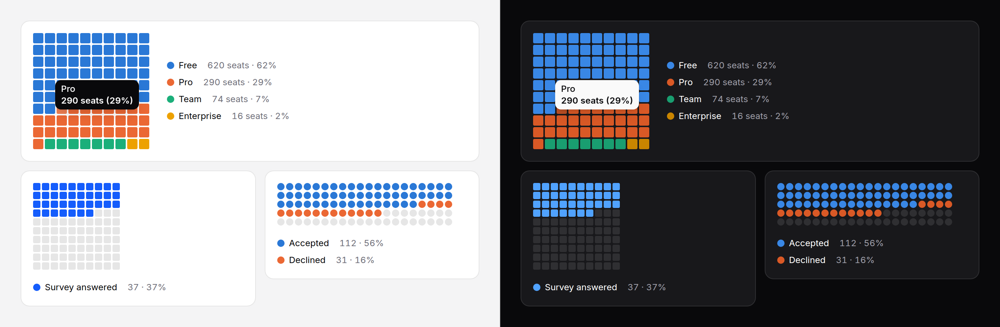

# Waffle chart

A 10 × 10 grid where each cell is 1%: one share ("37% answered") or a few
parts of a whole, countable at a glance. The grid is one image with a text
summary, not a hundred announced cells.



> **Needs Alpine** and the package's script for the readout and keyboard
> access to each part. Without them the grid is a correct static image with a
> generated text alternative. See
> [getting started](../getting-started.md#3-add-the-script).

## When to use it

For a share people should feel as a count: "37 in every 100", "1 in 5". A
[donut](donut-chart.md) shows the same parts as angles, which are read less
precisely; a [split bar](split-bar.md) takes a line instead of a square. For
comparing parts with each other, use a [bar chart](bar-chart.md).

## Use it

```blade
{{-- One number: a share of 100 --}}
<x-ds::waffle-chart label="Survey answered" :data="$answeredPercent" tone="accent" />

{{-- Parts of their sum --}}
<x-ds::waffle-chart label="Seats by plan" :data="['Free' => 620, 'Pro' => 290, 'Team' => 74]" :format="['suffix' => ' seats']" />

{{-- A whole with a natural count: 200 invitations, two to a cell --}}
<x-ds::waffle-chart label="Of 200 invited" :total="200" :rows="5" :columns="20" shape="circle"
    :data="['Accepted' => $accepted, 'Declined' => $declined]" />
```

## Props

| Prop | Type | Default | What it does |
|---|---|---|---|
| `data` | number or array | — | One number, a share of `total`; or `['Free' => 620, …]`, or rows with `label`, `value` and an optional `tone` or `series`. Zero or more each; negatives throw. Eight parts at most. |
| `total` | number | 100 for one number, else the sum | The whole the grid stands for. More than the parts leaves empty cells. |
| `rows` | int, 1 to 20 | `10` | Cells down. |
| `columns` | int, 1 to 20 | `10` | Cells across. |
| `label` | string | — | What the whole is; for one number, also its name in the legend. |
| `legend` | `beside` `below` `none` | `beside` | The legend, with each part's value and share. `beside` wraps underneath when there is no room. |
| `size` | `sm` `md` `lg` | `md` | A cell 10, 14 or 18px across. |
| `shape` | `square` `circle` | `square` | The cell. |
| `tone` | `neutral` `accent` `success` `warning` `danger` | — | For one number whose colour means something. Ignored with several parts (each takes its series colour, or its row's `tone` / `series`). |
| `format` | array | `[]` | How numbers read; [counter's keys](counter.md#format). |
| `summary` | string | generated | The text alternative, in place of the generated one. |
| `table` | bool | `false` | Also give part, value and share as a visually hidden table. |
| `interactive` | bool | `true` | With the script: the readout and keyboard access. |
| `empty` | string | `No data to show` | The empty state's title. |

Cells are shared out by largest remainder, so they always total the grid. A
part above zero always gets at least one cell, taken from the largest. Cells
fill in reading order: in a `dir="rtl"` page the first part starts at the
right.

## Accessibility

- Without the script the grid is `role="img"`: "Survey answered: 37 of 100
  (37%)", or for parts "Seats by plan: 3 parts, total 984; the largest is
  Free at 63%." The cells carry no names of their own.
- With it, one Tab stop and one stop per part, never per cell: any arrow
  moves part to part, Home and End to the ends, Escape puts the readout away.
  The pointer over any cell reads its part, beside that cell.
- `legend="none"` leaves colour as the only link between a part and its name
  on screen. Use it only for one number, or where the parts are named beside
  the chart.

## Don't

- **Don't change the grid to make a number fit.** 10 × 10 is what makes a
  cell read as 1%.
- **Don't use it for many small parts.** A part under a cell is drawn as one.
- **Don't use it for values that can be negative.** It throws.

More in [specs/waffle-chart.md](../../specs/waffle-chart.md).
